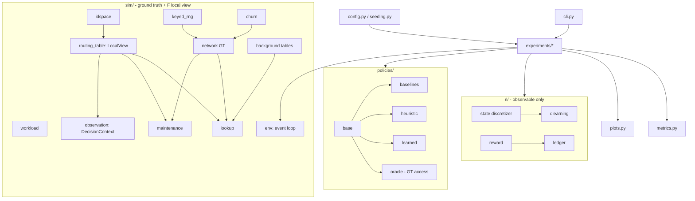
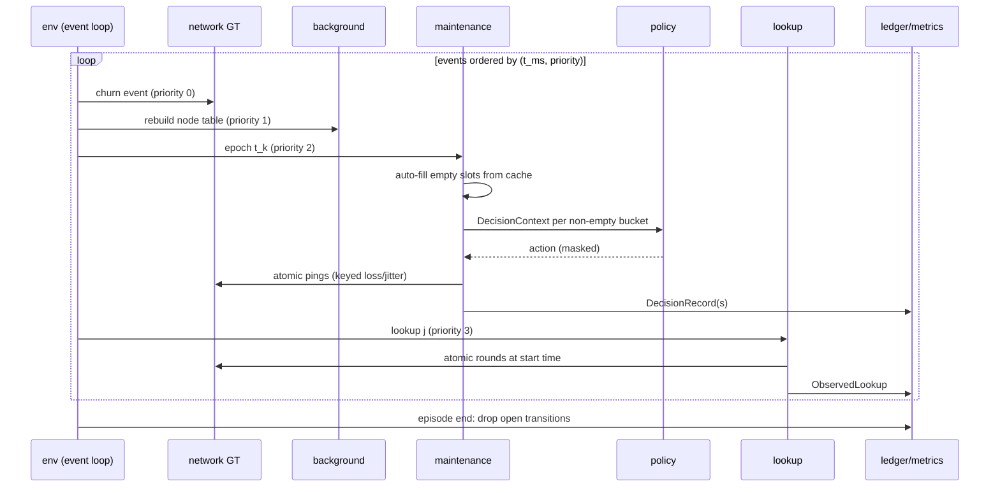
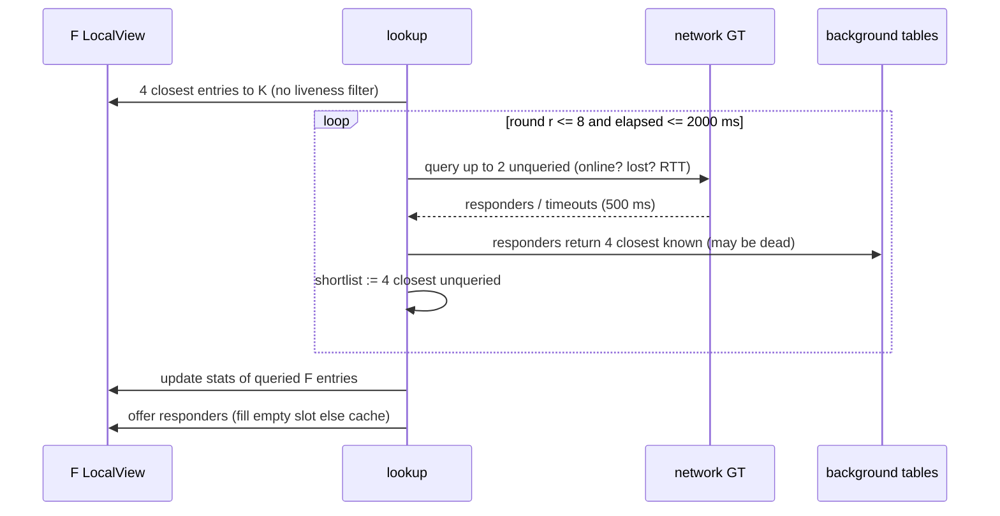

# Design Document: ChurnMaster

## Overview

ChurnMaster studies whether tabular Q-learning can learn an adaptive peer-replacement policy for the routing table of one focal node F in a simulated Kademlia-like DHT under node churn. The simulator is an event-driven, CPU-only, pure-Python model of 128 nodes with 8-bit IDs. F is the sole learner. Every 30 s, F makes one maintenance decision per non-empty bucket (KEEP, PROBE, REPLACE). The agent sees only what a real node could observe; hidden ground truth (online status, node type, congestion) is used only by the simulator, metrics, and the oracle reference policy.

The design encodes the agreed "ChurnMaster Revised Implementation Plan (v2)". All decisions below are settled. The problem is a POMDP: the discretized observation is treated as the state, and all claims are empirical. Policies differ only in the action they choose at shared decision points (except the labeled `kademlia_std` mode). Determinism given a root seed is a hard requirement. Randomness that must be identical across policies (loss, jitter, rebuild picks, bootstrap) comes from keyed hashing, so changing the policy cannot change those outcomes.

Constraints: Python 3.11+, exact pinned dependencies (numpy, scipy, pandas, matplotlib, pytest, hypothesis), TOML configs read with `tomllib`, no Gymnasium. `sim/` never imports `rl/` or `policies/`; only `experiments/*` wires components together.

## Architecture



Layering rules:
- `sim/` imports only stdlib, numpy, and other `sim/` modules.
- Observable-only modules (`rl/*`, `policies/*` except `oracle.py`, `sim/routing_table.py`, `sim/observation.py`) must not import `sim.network`, `sim.churn`, `sim.background`, `sim.lookup`, `sim.env`, `sim.keyed_rng`. Enforced by an AST import-guard test.
- `experiments/*` is the only layer that composes env, policies, ledger, agent, and metrics.

### Repository Layout

```
pyproject.toml  README.md  .gitignore (results/)
configs/base.toml
configs/scenarios/{stable,high_churn,heldout_medium,bursty}.toml
configs/experiments/{headroom,train,tune,eval}.toml
src/churnmaster/
  config.py seeding.py cli.py metrics.py plots.py
  sim/{idspace,keyed_rng,churn,workload,network,background,routing_table,lookup,maintenance,observation,env}.py
  rl/{state,reward,ledger,qlearning}.py
  policies/{base,baselines,heuristic,learned,oracle}.py
  experiments/{runner,headroom,diagnostics,train,tune_heuristic,evaluate,stats,reproduce}.py
tests/  (test_<module>.py per module, test_leakage.py, test_determinism.py, test_fairness.py)
docs/report.md
results/  (gitignored)
```

CLI subcommands: `show-config`, `simulate`, `compare`, `headroom`, `train`, `evaluate`, `reproduce`.

## Sequence Diagrams

### Episode event loop



### Atomic lookup



## Components and Interfaces

### config.py

```python
@dataclass(frozen=True)
class SimConfig:
    n_nodes: int = 128; id_bits: int = 8; k: int = 4; alpha: int = 2
    replicas: int = 3; cache_size: int = 4; cache_ttl_s: int = 300
    rebuild_period_s: int = 300; epoch_s: int = 30
    warmup_s: int = 600; measured_s: int = 2400
    lookup_rate_hz: float = 1.0; p_loss: float = 0.02
    timeout_ms: int = 500; deadline_ms: int = 2000; max_rounds: int = 8
    rtt_base_ms: float = 10.0; rtt_span_ms: float = 240.0; rtt_sigma: float = 0.25
    congestion_share: float = 0.10; congestion_len_s: int = 120
    congestion_gap_s: int = 1200; congestion_mult: float = 3.0
    window_timeout_s: int = 120; rtt_beta: float = 0.3

@dataclass(frozen=True)
class ScenarioConfig:
    name: str; stable_share: float
    stable_session_mean_s: float; flaky_session_mean_s: float
    downtime_mean_s: float; weibull_shape: float = 0.6; burn_in_s: int = 7200
    bursts: BurstConfig | None = None          # bursty only

@dataclass(frozen=True)
class RewardConfig:
    w_L: float = 0.3; w_M: float = 0.2; w_R: float = 0.3

@dataclass(frozen=True)
class AgentConfig:
    gamma: float = 0.9; alpha_min: float = 0.05; alpha_exp: float = 0.7
    eps_start: float = 1.0; eps_end: float = 0.05; eps_decay_frac: float = 0.6
    episodes: int = 200; runs: int = 3; validate_every: int = 20

@dataclass(frozen=True)
class Config:
    sim: SimConfig; scenario: ScenarioConfig; reward: RewardConfig
    agent: AgentConfig; experiment: ExperimentConfig; root_seed: int

def load_config(base: Path, scenario: Path, experiment: Path | None) -> Config: ...
def merge(base: dict, *overlays: dict) -> dict: ...      # deep merge, later wins
def validate(cfg: Config) -> None: ...                   # raises ConfigError
def config_hash(cfg: Config) -> str: ...                 # sha256 of canonical JSON
```

Scenario values:

| scenario | stable share | stable mean session | flaky mean session | mean downtime |
|---|---|---|---|---|
| stable | 0.70 | 4 h | 30 min | 20 min |
| high_churn | 0.30 | 1 h | 5 min | 10 min |
| heldout_medium (unseen) | 0.45 | 2 h | 10 min | 12 min |
| bursty (Task 11) | 0.50 | 2 h | 15 min | 15 min |

Bursty extras: every ~15 min (exponential gaps) 20% of online nodes nearest a uniformly random point leave within 10 s, return after Exp(mean 5 min), and nodes in that region have RTT ×2 for 3 min.

### seeding.py

```python
class Split(IntEnum):
    CALIBRATION = 0; TRAIN = 1; VALIDATION = 2; EVAL = 3; AGENT = 4; TEST = 5

def episode_seed(root: int, split: Split, run: int, episode: int) -> np.random.SeedSequence:
    return np.random.SeedSequence(root, spawn_key=(int(split), run, episode))

@dataclass(frozen=True)
class EpisodeStreams:          # children spawned from episode_seed
    ids: np.random.Generator; types_positions: np.random.Generator
    churn: np.random.Generator; congestion: np.random.Generator
    workload: np.random.Generator; keyed_root: int   # 64-bit
```

Eval seeds use `run=0` so every policy and every RL run sees identical eval environments. Agent exploration uses `episode_seed(root, AGENT, run, 0)`; random baselines use their own generator from `episode_seed(root, AGENT, run, 1000+policy_id)`.

### sim/idspace.py

```python
def xor_dist(a: int, b: int) -> int
def bucket_index(f: int, x: int) -> int   # floor(log2(f ^ x)), x != f, in [0, 7]
def closest(target: int, ids: Iterable[int], n: int) -> list[int]  # by XOR, ties impossible (unique ids)
def draw_ids(rng, n: int = 128, bits: int = 8) -> list[int]          # unique sample from 256
```

Convention: a lookup key K == F is attributed to bucket 0 (documented edge case).

### sim/keyed_rng.py

```python
class Purpose(IntEnum): LOSS=1; JITTER=2; BG=3; BOOT=4
class PingKind(IntEnum): INC=1; CAND=2; STD=3

def splitmix64(x: int) -> int                     # pure Python, mask 2**64-1
def keyed_uniform(root: int, purpose: int, *ids: int) -> float   # in [0, 1)
def keyed_normal(root: int, purpose: int, *ids: int) -> float    # Box-Muller of
    # keyed_uniform(..., *ids, 0) and keyed_uniform(..., *ids, 1)
```

Key schema (fixed):

| use | key |
|---|---|
| lookup query | (LOSS or JITTER, lookup_id, dst) |
| epoch ping | (LOSS or JITTER, epoch_idx, bucket, dst, kind∈{INC,CAND}) |
| kademlia_std ping | (LOSS or JITTER, lookup_id, bucket, dst, STD) |
| background rebuild | (BG, node, rebuild_idx) |
| F bootstrap | (BOOT, bucket, slot) |

### sim/churn.py

```python
@dataclass(frozen=True)
class Session: node: int; start_ms: int; end_ms: int

def generate_trace(scn: ScenarioConfig, types: list[NodeType], rng, horizon_ms: int,
                   focal: int) -> ChurnTrace
    # alternating Weibull(0.6, scale=mean/Γ(1+1/0.6)) sessions and Exp(downtime) gaps
    # from t = -burn_in; initial state online w.p. stationary fraction; F has one
    # session covering everything. Trace clipped to [0, horizon].
class ChurnTrace:
    def is_online(self, node: int, t_ms: int) -> bool
    def events(self) -> Iterator[ChurnEvent]       # (t_ms, node, up|down), sorted
    def online_at(self, t_ms: int) -> frozenset[int]
    def trace_hash(self) -> str
def analytic_online_fraction(scn) -> float   # share*m_s/(m_s+d) + (1-share)*m_f/(m_f+d)
```

### sim/workload.py

```python
@dataclass(frozen=True)
class LookupRequest: lookup_id: int; t_ms: int; key: int
def generate_workload(rng, rate_hz: float, start_ms: int, end_ms: int, bits: int) -> list[LookupRequest]
    # Poisson arrivals, integer ms, uniform keys, sequential lookup_id from 0
```

### sim/network.py (ground truth)

```python
@dataclass(frozen=True)
class NodeType: stable: bool
class Network:
    ids: list[int]; positions: np.ndarray; types: list[NodeType]
    trace: ChurnTrace; congestion: dict[int, list[tuple[int, int]]]; keyed_root: int
    def is_online(self, node: int, t_ms: int) -> bool
    def is_congested(self, node: int, t_ms: int) -> bool
    def rtt_ms(self, node: int, t_ms: int, key: tuple[int, ...]) -> float
        # (10 + 240*dist(F,node)/sqrt(2)) * exp(0.25*keyed_normal(JITTER,*key)) * (3 if congested)
    def query(self, node: int, t_ms: int, key: tuple[int, ...]) -> QueryResult
        # success iff online and keyed_uniform(LOSS,*key) >= p_loss; cost = RTT else 500
    def holders(self, key: int, t_ms: int) -> list[int]   # 3 online closest to key, excl. F
```

`QueryResult(success: bool, cost_ms: float, rtt_ms: float | None)`.

### sim/background.py

```python
class BackgroundTables:
    def rebuild(self, node: int, rebuild_idx: int, t_ms: int) -> None
        # per bucket of node: up to 4 online nodes chosen by keyed order (BG, node, rebuild_idx)
    def closest_known(self, node: int, target: int, n: int = 4) -> list[int]  # stale, may be dead
    def rebuild_schedule(self, horizon_ms) -> Iterator[tuple[int, int, int]]
        # (t_ms, node, idx): initial build at t=0, then node_idx*300000//N + 300000*m
```

### sim/routing_table.py (F's LocalView, observable)

```python
@dataclass
class Entry:
    node: int; inserted_ms: int; last_response_ms: int | None
    consec_fail: int = 0; srtt_ms: float | None = None
@dataclass
class CacheEntry: node: int; last_seen_ms: int; last_rtt_ms: float

class LocalView:
    def bucket(self, b: int) -> list[Entry]
    def all_entries(self) -> list[Entry]
    def closest_entries(self, target: int, n: int) -> list[Entry]
    def record_response(self, node, t_ms, rtt_ms)   # consec_fail=0, last_response=t, srtt EWMA β=0.3
    def record_failure(self, node, t_ms)            # consec_fail += 1
    def offer(self, node, t_ms, rtt_ms) -> OfferOutcome  # in table: noop; empty slot: insert; else cache
    def cache_put(self, b, node, t_ms, rtt_ms)      # dedupe; size 4 evicts oldest last_seen
    def cache_expire(self, t_ms)                    # TTL 300 s
    def autofill(self, b, t_ms) -> int              # fill empty slots from cache, most recent first, 0 msgs
    def incumbent(self, b) -> Entry                 # LRS: min(last_response or inserted), tie earlier insertion
    def candidate(self, b, t_ms) -> CacheEntry | None  # max last_seen, tie lower last_rtt
    def evict(self, node); def insert(self, b, node, t_ms, rtt_ms)
    def record_query_outcome(self, t_ms, timed_out: bool)  # sliding 120 s window
    def timeout_fraction(self, t_ms) -> float
```

Bootstrap: at t=0, for each bucket b, F fills slots with online nodes in bucket b ordered by `keyed_uniform(BOOT, b, slot)` selection. The selection is computed by `Network.bootstrap_entries()` (keyed, GT side) and passed to `LocalView.bootstrap(entries)`, so `routing_table.py` never imports `keyed_rng`.

### sim/lookup.py

```python
@dataclass(frozen=True)
class LookupResult:
    lookup_id: int; t_ms: int; key: int; bucket: int
    success: bool; latency_ms: float; rounds: int; queries: int
    fail_reason: Literal["deadline", "rounds", "exhausted"] | None
def run_lookup(req, view: LocalView, net: Network, bg: BackgroundTables, cfg) -> LookupResult
```

### sim/maintenance.py

```python
class Action(IntEnum): KEEP = 0; PROBE = 1; REPLACE = 2
@dataclass(frozen=True)
class ActionOutcome: pings: int; evictions: int; inserted: int | None; evicted: int | None
def apply_action(b, action, epoch_idx, t_ms, view, net, cfg) -> ActionOutcome
def kademlia_std_on_offer(b, newcomer, lookup_id, t_ms, view, net, cfg) -> ActionOutcome
```

### sim/observation.py

```python
@dataclass(frozen=True)
class DecisionContext:
    bucket: int; epoch_idx: int; t_ms: int
    inc_consec_fail: int; inc_since_response_s: float; inc_age_s: float
    inc_srtt_ms: float | None
    cand_since_seen_s: float | None; cand_last_rtt_ms: float | None
    timeout_fraction: float
def build_context(view: LocalView, b: int, epoch_idx: int, t_ms: int) -> DecisionContext
```

`inc_since_response_s` uses insertion time when the entry has never responded.

`ObservedLookup`, `DecisionRecord` (signatures under rl/ledger below), and `GTRecord` are also defined in `sim/observation.py`. The env can then emit them without importing `rl/`, and `rl/ledger.py` imports them from there, which the guard allows.

### sim/env.py

```python
class Env:
    def __init__(self, cfg: Config, streams: EpisodeStreams, mode: Literal["epoch", "kademlia_std"] = "epoch",
                 maintenance: bool = True)
    def run(self, decide: Callable[[DecisionContext], Action],
            on_decision: Callable[[DecisionRecord], None],
            on_lookup: Callable[[ObservedLookup], None],
            gt_annex: Callable[[GTRecord], None] | None = None,
            oracle_view: Callable[[int, int], OracleFacts] | None = None) -> EpisodeTrace
```

Event priorities at equal timestamp: churn (0) → rebuild (1) → maintenance epoch (2) → lookup (3); ties within a priority by node/bucket/lookup_id. Integer ms clock. `oracle_view` is only wired by experiments for `oracle_heuristic`.

### rl/state.py

```python
N_STATES = 648; N_REACHABLE = 540; N_ACTIONS = 3
@dataclass(frozen=True)
class Features: tier: int; inc_fail: int; inc_stale: int; inc_age: int
                cand: int; cand_faster: int; churn: int
def discretize(ctx: DecisionContext) -> Features
def encode(f: Features) -> int          # mixed radix (3,3,2,3,3,2,2)
def decode(s: int) -> Features
def allowed_actions(s: int) -> tuple[Action, ...]   # REPLACE only if cand != none
def reachable_states() -> list[int]     # cand_faster == 0 whenever cand == none
```

Bins: tier top(b=7)=0 / second(b=6)=1 / other=2; inc_fail 0/1/≥2; inc_stale <60 s / ≥60 s; inc_age <120 s / 120–1200 s / ≥1200 s; cand none / fresh (<30 s) / stale (30–300 s); cand_faster = 1 iff candidate exists, inc srtt known, cand last RTT < 0.7×inc srtt; churn timeout fraction <0.10 / ≥0.10.

### rl/reward.py, rl/ledger.py

```python
def lookup_loss(success: bool, latency_ms: float, w_L: float, deadline_ms=2000) -> float
    # (1 - S) + w_L * min(L / deadline, 1)  in [0, 1 + w_L]
def action_cost(pings: int, evictions: int, w_M: float, w_R: float) -> float

@dataclass(frozen=True)
class ObservedLookup: lookup_id: int; t_ms: int; bucket: int; success: bool; latency_ms: float; measured: bool
@dataclass(frozen=True)
class DecisionRecord: bucket: int; epoch_idx: int; t_ms: int; state: int | None
                      action: Action | None; pings: int; evictions: int; measured: bool

class Ledger:
    def add(self, rec: ObservedLookup | DecisionRecord) -> None   # TypeError otherwise
    def close_epoch(self, epoch_idx: int) -> list[Transition]     # (s, a, r, s') for buckets with a decision at k and k+1
    def total_reward(self) -> float      # sum over all measured bucket-epochs (incl. no-decision ones)
    def score(self) -> float             # J = 1 + total_reward / N_measured_lookups
```

`kademlia_std` ping costs are logged as `DecisionRecord(state=None, action=None, ...)` so they enter J.

### rl/qlearning.py

```python
class QAgent:
    Q: np.ndarray  # (648, 3) float64, init 0
    N: np.ndarray  # (648, 3) int64 update counts
    def act(self, s: int, eps: float, rng) -> Action        # ε-greedy over allowed_actions(s)
    def update(self, s, a, r, s_next) -> float               # returns |ΔQ|
    def alpha(self, s, a) -> float                           # max(alpha_min, (1+N[s,a])**-0.7)
    def save(self, path: Path); @classmethod load(cls, path) -> "QAgent"   # .npy
def epsilon(episode: int, cfg: AgentConfig) -> float         # linear 1.0→0.05 over first 60%
```

Greedy ties break by fixed order KEEP < PROBE < REPLACE (deterministic; chosen default).

### policies/

```python
class Policy(Protocol):
    name: str; shares_decision_points: bool = True
    def decide(self, ctx: DecisionContext) -> Action

# baselines.py
NeverReplace, AlwaysReplace (REPLACE if candidate else KEEP), UniformRandom(rng),
MatchedRandom(freqs: dict[bool, np.ndarray], rng), KademliaEpoch (PROBE if cand else KEEP),
KademliaStd (env mode="kademlia_std", decide -> KEEP, shares_decision_points=False)
# heuristic.py
@dataclass(frozen=True)
class HeuristicConfig: f: Literal[1, 2]; protect_old: bool; rtt_swap: bool
                       probe_stale: bool; tier_gate: Literal["all", "top_two"]
def all_configs() -> list[HeuristicConfig]    # 32
class Heuristic(Policy)                         # rule function on Features
def as_table(cfg) -> np.ndarray                 # (648,) action per state
# learned.py
class Learned(Policy)                           # greedy on frozen Q-table
# oracle.py (only module allowed GT access, via OracleFacts)
class OracleHeuristic(Policy)
```

`AlwaysReplace` uses REPLACE whenever a candidate exists, else KEEP. `UniformRandom` samples uniformly from allowed actions.

### metrics.py, experiments/, plots.py

```python
@dataclass(frozen=True)
class EpisodeMetrics:
    success_rate: float; p95_latency_success_ms: float; p95_latency_all_ms: float
    pings_per_hour: float; mean_latency_ms: float; evictions_per_hour: float
    messages_per_lookup: float; J: float
    dead_entry_fraction: list[tuple[int, float]]          # GT diagnostic
    actions_by_true_state: dict[tuple[str, int], int]     # GT diagnostic
def summarize(lookups, decisions, gt_records, cfg) -> EpisodeMetrics
def summary_hash(m: EpisodeMetrics) -> str
```

`experiments/runner.py` runs (policy, scenario, seed) jobs, sequential or via `multiprocessing` with identical results. Other experiment modules implement the gates and protocols below. `plots.py` produces online count, session histogram, learning curves, and comparison figures.

## Data Models

### Hidden vs observable

| Observable (LocalView / DecisionContext / ObservedLookup) | Hidden (Network / ChurnTrace / BackgroundTables / keyed values) |
|---|---|
| per-entry consecutive failures, time since last response, time since insertion, smoothed RTT (β=0.3) | online status, node type, sessions |
| candidate time since seen, last RTT | congestion intervals, true RTT parameters |
| F's 120 s timeout fraction | loss vs death of a timeout |
| F's lookup outcomes, bucket index | replica holders, other nodes' tables, keyed values |

Validation rules:
- `DecisionContext` is frozen and contains only observable fields.
- `Ledger.add` rejects anything other than `ObservedLookup` or `DecisionRecord`.
- `GTRecord` (true incumbent/candidate online state per decision, dead-entry fraction samples) flows only to `metrics.py`.
- Node IDs are unique in [0, 255]; F has a fixed index; F is online at all times.
- Session intervals per node are non-overlapping and sorted.
- Timestamps are integer ms; latency values are floats.

### Artifacts

- `results/<experiment>/manifest.json`: git hash, config hashes (frozen env hash from Task 6), package versions, seeds, eval-split lock.
- Q snapshots: `results/train/<grid>/run<r>/q_ep<e>.npy`; curves `curves.csv`.
- Eval tables: per-seed CSV, per-run CSV, H1–H5 table (CSV + Markdown).

## Algorithmic Pseudocode

### Lookup (atomic at t0)

```python
def run_lookup(req, view, net, bg, cfg):
    t0, K, j = req.t_ms, req.key, req.lookup_id
    holders = set(net.holders(K, t0))
    shortlist = [e.node for e in view.closest_entries(K, 4)]       # no liveness filter
    queried, elapsed, rounds = set(), 0.0, 0
    while True:
        batch = [n for n in closest(K, set(shortlist) - queried, cfg.alpha)]
        if not batch:
            return fail("exhausted", latency=elapsed)
        if rounds == cfg.max_rounds:
            return fail("rounds", latency=elapsed)
        rounds += 1
        results = {n: net.query(n, t0, (j, n)) for n in batch}
        queried |= set(batch)
        for n, r in results.items():                                # F-side side effects
            view.record_query_outcome(t0, not r.success)
            if n in view: (view.record_response(n, t0, r.rtt_ms) if r.success else view.record_failure(n, t0))
        hit = [r.rtt_ms for n, r in results.items() if r.success and n in holders]
        if hit and elapsed + min(hit) <= cfg.deadline_ms:
            offer_responders(results); return success(latency=elapsed + min(hit))
        elapsed += max(r.cost_ms for r in results.values())
        if elapsed > cfg.deadline_ms:
            offer_responders(results); return fail("deadline", latency=cfg.deadline_ms)
        learned = {c for n, r in results.items() if r.success for c in bg.closest_known(n, K, 4)}
        shortlist = closest(K, (set(shortlist) | learned) - queried - {F}, 4)
        offer_responders(results)          # responders -> view.offer(n, t0, rtt): empty slot else cache
```

Preconditions: `t0` is the event time; network state is read only at `t0`; F ∉ shortlist.
Postconditions: `success ⇒ latency ≤ 2000`; `fail ⇒ latency = give-up time` (2000 for deadline, elapsed otherwise); `rounds ≤ 8`; clock not advanced; result attributed to `bucket_index(F, K)`.
Loop invariant: `queried ∩ shortlist = ∅` after each round; `|batch| ≤ α`; `elapsed` equals the sum of completed round maxima.

### Decision epoch

```python
def on_epoch(k, t_k, view, policy, net, ledger, cfg):
    view.cache_expire(t_k)
    for b in range(8):
        view.autofill(b, t_k)
        if not view.bucket(b):
            ledger.add(DecisionRecord(b, k, t_k, None, None, 0, 0, measured(t_k)))  # drops open transition
            continue
        ctx = build_context(view, b, k, t_k)
        s = encode(discretize(ctx))
        a = policy.decide(ctx); assert a in allowed_actions(s)
        out = apply_action(b, a, k, t_k, view, net, cfg)
        ledger.add(DecisionRecord(b, k, t_k, s, a, out.pings, out.evictions, measured(t_k)))
```

### Actions

```python
def apply_action(b, a, k, t, view, net, cfg):
    inc, cand = view.incumbent(b), view.candidate(b, t)
    if a == KEEP: return Outcome(0, 0)
    if a == PROBE:
        r = net.query(inc.node, t, (k, b, inc.node, INC))
        if r.success: view.record_response(inc.node, t, r.rtt_ms); return Outcome(1, 0)
        view.record_failure(inc.node, t); view.evict(inc.node)
        if cand is None: return Outcome(1, 1)                       # slot left for auto-fill
        rc = net.query(cand.node, t, (k, b, cand.node, CAND))
        if rc.success: view.insert(b, cand.node, t, rc.rtt_ms)
        else: view.cache_drop(b, cand.node)
        return Outcome(2, 1)
    if a == REPLACE:                                                # requires cand
        rc = net.query(cand.node, t, (k, b, cand.node, CAND))
        if rc.success: view.evict(inc.node); view.insert(b, cand.node, t, rc.rtt_ms); return Outcome(1, 1)
        view.cache_drop(b, cand.node); return Outcome(1, 0)
```

All pings also feed `record_query_outcome`.

### kademlia_std (env mode)

On each responder offered to a full bucket during a lookup, right after the lookup (same t): ping the LRS incumbent with key (lookup_id, b, dst, STD). Fail → evict + insert newcomer (1 ping, 1 eviction). Success → refresh incumbent + cache newcomer (1 ping). Epoch actions are KEEP. Costs are logged as `DecisionRecord(state=None)` and count toward J.

### Reward and score

```python
# per bucket-epoch (b, k) over measured window
r[b,k] = -sum(lookup_loss(L) for L in lookups if L.bucket == b and t_k <= L.t < t_{k+1}) \
         - action_cost(pings[b,k], evictions[b,k])                 # empty -> 0 lookup term
J = 1 - mean(loss) - (w_M*total_pings + w_R*total_evictions) / N_lookups
  == 1 + sum(r) / N_lookups                                        # exact identity (tested)
```

Transitions `(s_{b,k}, a_{b,k}, r_{b,k}, s_{b,k+1})` with τ=1 are emitted when bucket b has decisions at both k and k+1. Transitions open at episode end or when bucket b becomes empty are dropped. Learning happens during warm-up; metrics and J use measured window only.

### Q update

```python
def update(self, s, a, r, s2):
    target = r + gamma * max(self.Q[s2, a2] for a2 in allowed_actions(s2))
    lr = max(alpha_min, (1 + self.N[s, a]) ** -0.7)
    delta = lr * (target - self.Q[s, a]); self.Q[s, a] += delta; self.N[s, a] += 1
    return abs(delta)

def epsilon(e, cfg):  # e in [0, episodes)
    E = cfg.eps_decay_frac * cfg.episodes
    return cfg.eps_end if e >= E else cfg.eps_start + (cfg.eps_end - cfg.eps_start) * e / E
```

Training: 200 episodes per run, episode e uses scenario stable if e even else high_churn, seed `episode_seed(root, TRAIN, run, e)`. Validation at episodes {0, 20, …, 200} on 5 validation seeds per training scenario with ε=0. The final Q-table is used for evaluation.

### Heuristic rule function

```python
def heuristic_action(cfg: HeuristicConfig, f: Features) -> Action:
    has_c = f.cand != NONE
    if f.inc_fail >= cfg.f:                                          # rule 1
        if cfg.protect_old and f.inc_age == OLD and f.inc_fail < 2: return PROBE
        return REPLACE if has_c else PROBE
    gated = cfg.tier_gate == "all" or f.tier in (TOP, SECOND)
    if gated and cfg.rtt_swap and f.cand_faster and f.cand == FRESH and f.inc_age == YOUNG:
        return REPLACE                                               # rule 2
    if gated and cfg.probe_stale and f.inc_stale == STALE and has_c:
        return PROBE                                                 # rule 3
    return KEEP                                                      # rule 4
```

### Oracle heuristic (GT, headroom reference only)

```python
def oracle_action(inc_online: bool, cand: CacheEntry | None, cand_online: bool) -> Action:
    if not inc_online and cand is not None and cand_online: return REPLACE
    if not inc_online: return PROBE
    return KEEP
```

Not an upper bound; no ordering vs other policies is assumed.

## Key Functions with Formal Specifications

### keyed_uniform(root, purpose, *ids)
- Pre: all args are non-negative ints < 2^64.
- Post: returns value in [0, 1); pure function of its arguments; no global state.

### discretize / encode / decode
- Pre: `ctx` built by `build_context` from a non-empty bucket.
- Post: `encode(f) ∈ [0, 648)`; `decode(encode(f)) == f`; reachable outputs ⊆ 540 states.

### allowed_actions(s)
- Post: always contains KEEP and PROBE; contains REPLACE iff `decode(s).cand != none`.

### Ledger.score()
- Pre: at least one measured lookup.
- Post: equals `1 − mean(ℓ) − (w_M·pings + w_R·evictions)/N` within float tolerance 1e-9.

### QAgent.update
- Pre: `a ∈ allowed_actions(s)`.
- Post: `N[s,a]` incremented by 1; only `Q[s,a]` changes; since r ≤ 0 and Q init 0, `Q ≤ 0` holds forever.

## Experiment Protocols

### Headroom gate and env freeze (Task 6)
10 calibration seeds × {stable, high_churn}.
(revised: gates on J/p95 per user decision after checkpoint 5.17 — never_replace already reached ~99% success in high_churn, so success-pp gates could not discriminate; J and p95 latency do.)
- G1: in high_churn, "best" = the policy among {kademlia_epoch, always_replace, oracle_heuristic} with the largest mean paired ΔJ vs never_replace (all three are reported). G1 passes if best has ΔJ ≥ `g1_min_dJ` (0.01) with paired bootstrap CI (10k resamples, 95%) lo > 0, OR mean per-seed relative p95_latency_all_ms reduction (nr − p)/nr ≥ `g1_min_p95_rel` (0.20) with the paired CI on the ms difference (nr − p) having lo > 0.
- G2: oracle_heuristic vs kademlia_epoch in high_churn: ΔJ ≥ `g2_min_dJ` (0.01) with CI lo > 0, OR pings ratio (mean oracle pings / mean kademlia pings) ≤ `g2_max_ping_ratio` (0.6) with mean ΔJ ≥ −`g2_J_tol` (0.005). If G2 fails, proceed and report limited headroom.
- If G1 fails, tune deadline {1000, 1500, 2000} ms, loss {1, 2, 5}%, replicas {1, 2, 3} on high_churn calibration seeds only; settings are tried in order of distance from the default (number of changed parameters, then |Δ| in grid steps) and the first passing setting is reported as overrides in gates.json/manifest (base configs are not edited). Exit code 3 if no setting passes.
- Freeze: `manifest.json` records `env_hashes` {scenario: sha256 over the `sim` + `scenario` sections} for every scenario in `configs/scenarios/` (including heldout_medium and bursty), plus git hash and package versions. `check_frozen` raises `FrozenEnvError` when a run's env hash differs; reward/agent/experiment changes do not alter the env hash.

### Reward diagnostics (Task 7)
- Reward-total identity holds exactly.
- Reward sanity: for incumbents that are truly dead in top/second tiers, PROBE/REPLACE discounted return > KEEP; for live incumbents, KEEP > REPLACE; CIs exclude 0.
- Coverage: ≥80% of decisions fall in states visited ≥50 times over 20 episodes.
- Spearman correlation of J vs success rate reported.

### Training (Task 8)
8a: high_churn debug, 1 run × 100 episodes. 8b: grid γ ∈ {0.8, 0.9} × α_min ∈ {0.02, 0.05}, pick by mean validation J over the last 3 checkpoints. 8c: 3 runs with the chosen setting. Save `.npy` snapshots and `.csv` curves.

### Tuning, evaluation, statistics (Task 9)
- Heuristic: all 32 configs on 10 train seeds per scenario. Global best is tuned on stable + high_churn. Per-scenario best is reported as "privileged".
- matched_random: RL action frequencies per scenario, split by candidate presence, measured on validation seeds.
- Eval: 20 eval seeds × {stable, high_churn, heldout_medium} × all policies × all 3 RL runs. Eval split locked via manifest (seed list hash; evaluate refuses mismatched or unlocked split).
- Stats: paired per-seed differences (RL averaged over 3 runs minus baseline). Bootstrap 10k resamples, 95% percentile CI. Wilcoxon signed-rank. Holm correction over 9 primary tests: RL vs {kademlia_epoch, tuned heuristic, matched_random} × 3 scenarios on J. Per-run results are also reported. H1–H5 table generated automatically.

### Acceptance

Implementation (required): I1 simulator tests pass; I2 determinism + keyed invariance across policies; I3 leakage guards and counterfactual pass; I4 agent learns (toy MDP; all 3 runs beat the episode-0 checkpoint on validation J with paired CI excluding 0; shrinking mean |ΔQ|); I5 fairness (identical traces, shared decision points except labeled kademlia_std, representability, heuristic 32 configs vs RL 4 grid points); I6 `reproduce` regenerates all tables and figures.

Hypotheses (tested and reported, not required): H1 RL > matched_random on J in every scenario. H2 high_churn: RL non-inferior (within 1 pp success) to kademlia_epoch and tuned heuristic, and significantly better on ≥1 primary metric. H3 RL pings ≤ kademlia_epoch and p95 within 5% of best baseline. H4 H2 holds on heldout_medium. H5 all 3 runs individually in H2's direction. Honest negative results are acceptable.

### Extensions (optional)
Task 11: bursty scenario. Task 12 ablations: γ=0, no PROBE, shuffled reward, feature drop-one, w_M {0.05, 0.2, 0.5} × w_L {0.1, 0.3, 0.6} sweep, memoryless held-out scenario.

## Example Usage

```python
cfg = load_config(Path("configs/base.toml"), Path("configs/scenarios/high_churn.toml"),
                  Path("configs/experiments/train.toml"))
streams = make_streams(episode_seed(cfg.root_seed, Split.EVAL, 0, 7))
ledger, lookups, decisions = Ledger(cfg.reward), [], []
env = Env(cfg, streams)
env.run(decide=KademliaEpoch().decide,
        on_decision=lambda d: (ledger.add(d), decisions.append(d)),
        on_lookup=lambda l: (ledger.add(l), lookups.append(l)))
m = summarize(lookups, decisions, [], cfg)
assert abs(m.J - ledger.score()) < 1e-9
```

```text
churnmaster show-config --scenario high_churn
churnmaster compare --scenario high_churn --seeds 5 --policies never_replace,kademlia_epoch
churnmaster reproduce --quick      # 1 run, 40 episodes, 5 eval seeds, < 10 min
```

## Correctness Properties

*A property is a characteristic or behavior that should hold true across all valid executions of a system-essentially, a formal statement about what the system should do. Properties serve as the bridge between human-readable specifications and machine-verifiable correctness guarantees.*

All properties are implemented with Hypothesis (≥100 examples, except episode-level properties 19–21, which use shortened episodes and a reduced but documented `max_examples`). Statistical criteria (KS uniformity, online fraction, loss rate, survival, Poisson rate) are fixed-seed example tests, not properties.

### Property 1: Config merge precedence and hash canonicality

*For any* base dict and overlay dicts, every key of the merged config takes the value from the last layer that defines it. `config_hash` is unchanged under key reordering and changes when any leaf value changes.

**Validates: Requirements 1.1, 1.4**

### Property 2: Invalid configs are rejected

*For any* valid config mutated by adding an unknown key, changing a value's type, or moving a value out of range, validation raises ConfigError naming that key.

**Validates: Requirements 1.3**

### Property 3: Seed split disjointness

*For any* two distinct (split_id, run, episode) triples, the derived SeedSequence states differ.

**Validates: Requirements 2.3**

### Property 4: XOR geometry and bucket index

*For any* distinct 8-bit ids a, b, c: `d(a,a)=0`, `d(a,b)=d(b,a)>0`, and `d(a,b)=d(a,c) ⇒ b=c`. For any F ≠ x, `b = bucket_index(F,x)` satisfies `0 ≤ b ≤ 7` and `2^b ≤ F⊕x < 2^(b+1)`. For any seed, `draw_ids` returns 128 unique ids in [0, 255].

**Validates: Requirements 3.1, 3.2, 3.3**

### Property 5: Closest selection matches sorting model

*For any* target and id set, `closest(target, ids, n)` equals the first n elements of `sorted(ids, key=xor to target)`.

**Validates: Requirements 3.5, 8.4**

### Property 6: Keyed RNG determinism and purity

*For any* (root, purpose, ids), `keyed_uniform` returns a value in [0, 1). Repeated calls, including calls interleaved with arbitrary other keyed calls, return the identical value. The same holds for `keyed_normal`.

**Validates: Requirements 4.1, 4.2, 4.3**

### Property 7: Churn trace well-formedness

*For any* scenario and seed, each node's sessions are sorted and non-overlapping, F is online at every time in [0, horizon], and regenerating with the same seed yields the identical trace hash.

**Validates: Requirements 5.3, 5.4, 5.7**

### Property 8: Workload well-formedness

*For any* seed, workload timestamps are non-decreasing integers in the episode window, keys are in [0, 255], and lookup_ids are exactly 0..N−1 in order.

**Validates: Requirements 6.1, 6.2**

### Property 9: Network query and RTT semantics

*For any* node, time, and key tuple, `query` succeeds iff the node is online and `keyed_uniform(LOSS, *key) ≥ p_loss`. On success, the cost equals `(10 + 240·dist/√2)·exp(0.25·keyed_normal(JITTER,*key))·(3 if congested)`. On failure, the cost equals 500 ms.

**Validates: Requirements 7.3, 7.4**

### Property 10: Replica holders model

*For any* key and time, `holders(K, t)` equals the 3 XOR-closest online nodes to K excluding F, and all holders are online at t.

**Validates: Requirements 7.6**

### Property 11: Background table rebuild and staleness

*For any* seed, rebuild times equal `node_idx·300000//N + 300000·m` ms. After a rebuild, every entry was online at the rebuild time, lies in the correct bucket of its owner, and each bucket holds ≤ 4 entries. Between rebuilds, the table is unchanged regardless of churn.

**Validates: Requirements 8.1, 8.2, 8.3**

### Property 12: LocalView invariants under arbitrary operation sequences

*For any* sequence of offer, record_response, record_failure, evict, insert, autofill, and cache_expire operations: every bucket holds ≤ 4 entries, each in its correct bucket, with no duplicates across table and cache. Each cache holds ≤ 4 entries, none older than 300 s after expiry. Offering a non-member inserts it iff its bucket had an empty slot, else places it in the cache. srtt follows the β=0.3 EWMA. After `autofill`, bucket size equals min(4, prior size + valid cache size) and no pings are counted.

**Validates: Requirements 9.1, 9.2, 9.4, 9.5, 14.1**

### Property 13: Incumbent, candidate, and timeout-fraction selection

*For any* non-empty bucket and cache, `incumbent` equals the minimum by (last_response or inserted, inserted), and `candidate` equals the maximum by (last_seen, −last_rtt), or none. *For any* sequence of query outcomes, `timeout_fraction(t)` equals the fraction of timeouts among outcomes in (t−120 s, t].

**Validates: Requirements 9.6, 9.7, 9.8**

### Property 14: Lookup termination and latency contract

*For any* network state, LocalView, and lookup request: rounds ≤ 8, queries ≤ 2·rounds, and `bucket == bucket_index(F, K)`. If successful, some holder responded and latency ≤ 2000 ms equals the prior round durations plus that holder's RTT. If failed with "deadline", latency = 2000. If failed with "rounds" or "exhausted", latency equals the elapsed round time.

**Validates: Requirements 10.2, 10.4, 10.5, 10.9**

### Property 15: Lookup atomicity

*For any* lookup at t0, altering the churn trace only at times > t0 does not change the LookupResult, and the env clock is unchanged by the lookup.

**Validates: Requirements 10.6**

### Property 16: Discretizer round-trip and binning

*For any* Features value, `decode(encode(f)) == f` and `encode(f) ∈ [0, 648)`. *For any* DecisionContext, each feature lies in the bin given by its thresholds, cand_faster is yes iff a candidate exists, the inc srtt is known, and the cand RTT < 0.7·srtt, and `encode(discretize(ctx))` is in the reachable set of size 540.

**Validates: Requirements 13.1, 13.2, 13.3, 13.4**

### Property 17: Action masking

*For any* state s, `allowed_actions(s)` contains KEEP and PROBE, and contains REPLACE iff decode(s).cand ≠ none. *For any* state, ε, and seed, `QAgent.act`, uniform_random, matched_random, every heuristic config, and every baseline return an allowed action.

**Validates: Requirements 13.5, 16.3, 17.1, 17.5**

### Property 18: Action outcome contract

*For any* bucket state, candidate cache, action allowed in that state, and keyed ping outcomes: KEEP → (0 pings, 0 evictions, bucket unchanged); PROBE with live incumbent → (1, 0, incumbent refreshed); PROBE with failed incumbent → incumbent evicted, then (1, 1) if no candidate, else (2, 1) with the candidate inserted iff it answers, otherwise dropped from the cache; REPLACE → (1, 1, candidate swapped in) if the candidate answers, else (1, 0, candidate dropped, incumbent kept).

**Validates: Requirements 14.3, 14.4, 14.5, 14.6, 14.7**

### Property 19: Determinism

*For any* seed, scenario, and deterministic policy, running the same episode twice yields identical metric summary hashes and identical ledger contents.

**Validates: Requirements 11.5, 5.7**

### Property 20: Cross-policy fairness

*For any* seed and any two epoch-mode policies, the episodes have identical churn trace hashes, identical workloads, identical epoch decision times, and identical loss/jitter outcomes for every (key tuple, destination) both policies query.

**Validates: Requirements 21.1, 21.2, 21.4**

### Property 21: Counterfactual leakage

*For any* DecisionContext and any two ground-truth states consistent with it (e.g., incumbent online vs offline, different node types), every non-oracle policy returns the same action.

**Validates: Requirements 12.4**

### Property 22: Reward-total identity

*For any* sequence of measured ObservedLookups (with N ≥ 1) and DecisionRecords, including kademlia_std cost records, `1 − mean(ℓ) − (w_M·pings + w_R·evictions)/N == 1 + Σ_{b,k} r_{b,k}/N` within 1e-9, and `Metrics.J == Ledger.score()`.

**Validates: Requirements 15.2, 15.3, 15.4, 15.5, 20.4**

### Property 23: Lookup loss range

*For any* success flag and latency ≥ 0, ℓ ∈ [0, 1 + w_L], and ℓ is non-decreasing in latency.

**Validates: Requirements 15.1**

### Property 24: Transition construction

*For any* scripted record sequence, the Ledger emits a transition for bucket b at epoch k iff b has non-null decisions at both k and k+1. The transition's reward equals r_{b,k}, and no transition spans an episode end or an empty-bucket epoch.

**Validates: Requirements 15.6, 15.7**

### Property 25: Q-update contract

*For any* Q-table with entries ≤ 0, any allowed (s, a), any r ≤ 0, and any s', `update` changes only Q[s,a], increments N[s,a] by 1, applies the stated formula with `α = max(α_min, (1+n)^−0.7)`, and keeps all Q ≤ 0.

**Validates: Requirements 16.2**

### Property 26: Epsilon schedule

*For any* episode count E and episode e, ε(0)=1.0, ε is non-increasing in e, ε(e)=0.05 for e ≥ 0.6·E, and ε is linear in between.

**Validates: Requirements 16.3**

### Property 27: Q-table save/load round-trip

*For any* Q and N arrays, saving then loading yields arrays equal to the originals.

**Validates: Requirements 16.5**

### Property 28: Heuristic representability

*For any* of the 32 heuristic configs and any DecisionContext, the action from the config's 540-state table at `encode(discretize(ctx))` equals the rule function's action.

**Validates: Requirements 18.1, 18.2, 18.4**

### Property 29: Oracle decision rule

*For any* combination of incumbent online status, candidate presence, and candidate online status, the oracle returns REPLACE iff the incumbent is offline and the candidate is present and online, PROBE iff the incumbent is offline otherwise, and KEEP otherwise.

**Validates: Requirements 19.1**

### Property 30: Holm correction monotonicity

*For any* vector of 9 p-values, the Holm-adjusted p-values are ≥ the raw p-values, ≤ 1, and preserve the order of the raw p-values.

**Validates: Requirements 25.5**

## Error Handling

### Invalid configuration
**Condition**: unknown key, wrong type, out-of-range value (e.g., p_loss ∉ [0,1), k < 1, shares ∉ [0,1]).
**Response**: `ConfigError` naming the key and file. **Recovery**: none; CLI exits non-zero.

### Illegal action
**Condition**: policy returns an action not in `allowed_actions(s)`.
**Response**: `IllegalActionError` raised by `sim/maintenance.apply_action` (REPLACE with no candidate) during the env's epoch handling. `sim/` checks candidate presence directly instead of importing `rl/state`. The agent never samples masked actions.

### Ledger misuse
**Condition**: object other than `ObservedLookup`/`DecisionRecord` passed. **Response**: `TypeError`.

### Eval-split violation
**Condition**: eval seeds overlap other splits, or evaluate is run without a matching lock in the manifest.
**Response**: `SplitLockError`; no results written.

### Frozen env mismatch
**Condition**: training/eval config hash differs from the frozen env hash. **Response**: refuse to run unless `--allow-unfrozen` (tests and debug only).

### Lookup edge cases
Empty shortlist → immediate failure "exhausted" at latency 0. K == F → bucket 0.

## Testing Strategy

### Unit testing
pytest per module (`tests/test_<module>.py`) plus `test_leakage.py`, `test_determinism.py`, `test_fairness.py`. Hand-computed lookup latency, scripted ledger, hand Q update, toy 2-state MDP within 0.05 of analytic Q*, baseline actions on hand-made contexts, stats on synthetic data. Slow tests (episode timing, multi-episode diagnostics) use `@pytest.mark.slow`.

### Property-based testing
**Property Test Library**: Hypothesis (pinned). Minimum 100 examples per property. Each test is tagged `Feature: churnmaster, Property N: <title>`. Targets: idspace, keyed RNG, discretizer, masking, reward/ledger identity, Q update invariants, heuristic representability, determinism/fairness (with small `max_examples` for expensive episode-level properties, using shortened episodes).

### Integration testing
Short full episodes per policy; maintenance-off run; demo `compare`; `reproduce --quick` smoke.

## Performance Considerations

- Maintenance-off 3000 s episode ≤ 2 s on CPU (slow-marked test).
- Pure-Python keyed RNG; `closest` over ≤128 ints; churn status by bisect over per-node sorted session starts.
- Experiments parallelize over (policy, seed) via `multiprocessing`; results identical to sequential.
- Atomic lookups and pings (no in-flight overlap) are a documented modeling limitation.

## Security Considerations

No network services, no external I/O beyond reading configs and writing `results/`. TOML is parsed with `tomllib` (no code execution). Dependencies are exactly pinned.

## Dependencies

Python ≥3.11 stdlib (`tomllib`, `dataclasses`, `multiprocessing`, `hashlib`, `json`, `ast`). Exact pins in `pyproject.toml` (versions fixed at scaffold time, e.g. numpy==2.1.3, scipy==1.14.1, pandas==2.2.3, matplotlib==3.9.2, pytest==8.3.3, hypothesis==6.115.0). No Gymnasium.
