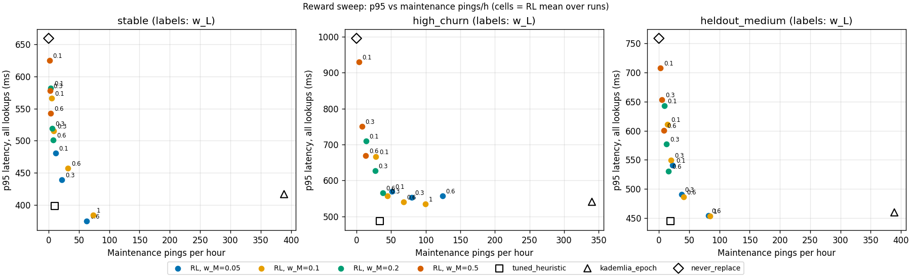

# ChurnMaster — Final Results (v1.1.0)

This is the consolidated record of the ChurnMaster project. It covers the simulator, the evaluation protocol, the primary results and the exploratory ablations. It can be read without the development conversation or the Git history. It covers release **v1.1.0** (commit `b746d9b`). The original release **v1.0.0** (commit `2f997a0`) is still tagged and unchanged.

Detailed artifacts:
- [`docs/report.md`](docs/report.md): the full study report.
- [`README.md`](README.md): install and commands.
- [`.kiro/specs/churnmaster/`](.kiro/specs/churnmaster/): requirements, design and task list.
- [`results/figures/`](results/figures/): tracked figures and tables.

**How to read the numbers.**
- Primary results come from the canonical files in `results/eval/` (`summary.csv`, `primary_tests.csv`, `per_run.csv`, `hypotheses.csv`) and are quoted at their stored precision, rounded.
- Every difference is written as **A − B** with the order stated. A positive ΔJ means A scores higher. A positive Δp95 or Δpings means A is *slower* or sends *more*.
- Labels used throughout:
  - **[measured]**: read directly from a canonical result file.
  - **[derived here]**: computed for this document from canonical per-seed data. It is not stored in any result file.
  - **[exploratory]**: post-hoc ablation on separate seeds with uncorrected p-values.
  - **[interpretation]**: the authors' reading of the evidence.
  - **[proposed]**: future work that has not been done.

---

## 1. Executive summary

ChurnMaster asks whether a **tabular Q-learning agent** can maintain the routing table of one node in a Kademlia-like distributed hash table (DHT) better than hand-written rules while peers join and leave (churn).

- **Setup.** A focal node F, in a deterministic 128-node discrete-event simulator, decides KEEP, PROBE or REPLACE every 30 s for the least-recently-seen contact of each non-empty bucket. It sees only locally observable signals.
- **Score.** Policies are compared on one score, J. J combines lookup failure, lookup latency, and the cost of maintenance pings and evictions.

**Main results** (locked evaluation: 20 evaluation seeds × 3 scenarios, one of them unseen in training) **[measured]**:

| finding | evidence |
|---|---|
| RL beats Kademlia-style epoch maintenance (`kademlia_epoch`) on J in every scenario | ΔJ (RL − kademlia_epoch) = +0.0097 / +0.0085 / +0.0089 (stable / high_churn / heldout_medium), all Holm-adjusted p = 1.7·10⁻⁵ |
| RL sends far fewer *maintenance pings* than kademlia_epoch | 98.1% / 87.05% / 93.9% fewer pings per hour |
| The improvement does not come only from acting less often | RL beats a random policy with RL's own action frequencies (H1 pass): ΔJ +0.0149 / +0.0127 / +0.0126 |
| It transfers to the unseen churn level | heldout_medium shows effect sizes similar to the training scenarios |
| **RL is worse than the tuned rule-based heuristic** | ΔJ (RL − tuned_heuristic) = −0.0021 / −0.0030 / −0.0020, all Holm-significant |
| RL has higher tail latency | p95 is 18–38% above the best eligible baseline (H3 fail) |

**Most important limitation.** The custom simulator leaves very little headroom. With no maintenance at all, lookup success is still 98.3–99.5% on the evaluation seeds. The tuned heuristic already matches or beats a ground-truth oracle on J. The learned policy is a frugal, competent maintainer, but it is not better than a well-tuned rule family. All results come from one simplified simulator, so they say nothing direct about real deployments.

---

## 2. Research question and hypotheses

**Research question.** Under churn, can a Q-learned maintenance policy that uses only observable signals trade maintenance messages against lookup success and latency better than:
- (a) Kademlia-style maintenance,
- (b) a random policy with matched action frequencies, and
- (c) a tuned rule-based heuristic?

And does it generalize to a churn level it was not trained on?

H1–H5 were pre-registered in the design. Their verdicts are computed automatically by `experiments/stats.py` (`hypothesis_table`) and stored in [`results/figures/tables/hypotheses.md`](results/figures/tables/hypotheses.md). Each verdict is pass, fail or inconclusive. For combined verdicts, every part must pass for a pass, any failing part gives a fail, and anything else is inconclusive.

| id | definition (decision rule) | verdict | key evidence [measured] |
|---|---|---|---|
| H1 | RL > matched_random on J in every scenario. Pass if every scenario's test is Holm-significant (α = 0.05) with mean > 0. | **pass** | ΔJ +0.01495 [+0.00609, +0.02952] / +0.01272 [+0.01005, +0.01601] / +0.01258 [+0.00529, +0.02352]; p_Holm ≤ 3.81·10⁻⁵ |
| H2 | high_churn: RL is non-inferior on success to kademlia_epoch **and** to tuned_heuristic, and significantly better on ≥ 1 primary metric. Non-inferior means the CI lower bound of Δsuccess > −0.01 (1 pp). Primary metrics are success, p95 and pings/h; **J is not one of them**. | **inconclusive** | vs kademlia_epoch: Δsuccess +0.00127 [−0.00037, +0.00345], better on pings/h → pass. vs tuned_heuristic: Δsuccess −0.00053 [−0.00163, +0.00047], better on none → inconclusive |
| H3 | In every scenario: RL pings/h ≤ kademlia_epoch (CI upper bound ≤ 0), **and** RL p95 ≤ 1.05 × the best baseline's p95. oracle_heuristic and tuned_heuristic_privileged are excluded from "best". | **fail** | The pings condition holds everywhere (Δpings −376.8 / −294.2 / −346.1 per hour). p95 ratios: 456.6/362.0 = 1.261 (best = default `heuristic`); 553.8/468.4 = 1.182 (tuned); 521.3/378.7 = 1.377 (tuned) |
| H4 | H2 on heldout_medium | **inconclusive** | Same pattern: pass vs kademlia_epoch (pings), inconclusive vs tuned_heuristic |
| H5 | high_churn: each of the 3 RL runs individually has the same J sign as the pooled result vs each H2 comparator, and is non-inferior on success | **pass** | vs kademlia_epoch: +0.00823 / +0.00686 / +0.01051. vs tuned_heuristic: −0.00332 / −0.00470 / −0.00105 |

**What the verdicts mean** **[interpretation]**:
- **H5.** "Pass" means the three runs *agree with the pooled direction*. Against the tuned heuristic, they agree that RL is **worse**.
- **H2 and H4.** These are "inconclusive" rather than "fail" because the rule only declares failure if RL is clearly inferior on success, or if every primary metric's CI is entirely unfavourable. RL's success-rate CI against the tuned heuristic includes favourable values.
- **J in H2/H4.** J is not a primary metric in H2/H4. On J, Table 8 shows RL is significantly worse than the tuned heuristic. Read substantively, the tuned-heuristic comparison is a negative result.
- **Changes.** This document does not alter any verdict.

---

## 3. System design

Source: [`src/churnmaster/`](src/churnmaster/). Design document: [`.kiro/specs/churnmaster/design.md`](.kiro/specs/churnmaster/design.md).

### 3.1 Simulator architecture

The simulator is a pure-Python, CPU-only, deterministic discrete-event simulator. It does not use Gymnasium. Ground truth and F's local view are separate modules:

| layer | modules | role |
|---|---|---|
| ground truth | `sim/idspace`, `sim/churn`, `sim/workload`, `sim/network`, `sim/background` | XOR ID space, per-node session/downtime traces, Poisson lookup workload, RTT/loss/congestion, other nodes' (stale) routing tables |
| F's view | `sim/routing_table` (LocalView), `sim/observation`, `sim/lookup`, `sim/maintenance` | F's buckets, replacement cache and bookkeeping; atomic iterative lookups; action execution |
| loop | `sim/env` | event loop with warm-up/measured phases and 30 s decision epochs |
| learning | `rl/state`, `rl/reward`, `rl/ledger`, `rl/qlearning`, `rl/variants` | observable-only discretizer, loss/cost terms, transition construction, Q-table |
| policies | `policies/baselines`, `heuristic`, `learned`, `oracle`, `ablated` | all compared policies; only `oracle.py` may read ground truth |
| experiments | `experiments/{runner,headroom,diagnostics,train,tune_heuristic,matched,evaluate,stats,reproduce,ablations}` | protocols, statistics, reproduction |

### 3.2 DHT and routing-table model

Values from [`configs/base.toml`](configs/base.toml):

| parameter | value |
|---|---|
| nodes / ID space | 128 nodes, 8-bit IDs → 8 buckets for F |
| bucket size k / lookup parallelism α / replicas | 4 / 2 / 3 closest online nodes |
| replacement cache | 4 entries per bucket, TTL 300 s |
| lookups | Poisson at 1 per s with uniform keys. At most 8 rounds, 500 ms per-query timeout, 2000 ms deadline |
| RTT | (10 + 240·dist/√2) · exp(0.25·N(0,1)) ms. 10% of nodes are congested (RTT ×3) for 120 s about every 20 min |
| packet loss | 2% |
| episode | 600 s warm-up + 2400 s measured (≈ 2,406 measured lookups per episode on average); decisions every 30 s |
| other nodes' tables | rebuilt every 300 s (staggered) from online nodes and stale in between. Only F adapts |

### 3.3 Peer churn

- **Session model.** Each node is either *stable* or *flaky*. It alternates Weibull sessions with exponential downtimes, starting after a 2 h burn-in. The Weibull scale is mean/Γ(1 + 1/shape), so the shape changes the hazard but not the mean. F itself is always online.
- **Hazard shape.** With shape 0.6, the hazard decreases with age: a contact that has been online longer is more likely to stay online.

| scenario | stable share | stable session mean | flaky session mean | downtime mean | Weibull shape | role |
|---|---|---|---|---|---|---|
| `stable` | 0.70 | 4 h | 30 min | 20 min | 0.6 | train, tune, eval |
| `high_churn` | 0.30 | 1 h | 5 min | 10 min | 0.6 | train, tune, eval |
| `heldout_medium` | 0.45 | 2 h | 10 min | 12 min | 0.6 | **eval only** (unseen in training and tuning) |
| `bursty` | 0.50 | 2 h | 15 min | 15 min | 0.6 | configured, frozen, **never evaluated** (Task 11 not done; see §9) |
| `heldout_memoryless` | 0.45 | 2 h | 10 min | 12 min | **1.0** | exploratory §7.3 only; lives in `configs/ablations/` |

**Policy-independent randomness.** Packet loss, RTT jitter, background rebuilds and F's bootstrap all come from a keyed hash (splitmix64) of the event identity (`sim/keyed_rng.py`). Two policies that send the same ping in the same epoch and bucket therefore see the same outcome. Churn traces and workloads come from per-episode `SeedSequence` streams. They are identical across policies, and tests check this via trace and workload hashes.

### 3.4 Lookup behaviour

- **Atomic lookups.** Each lookup is iterative (α = 2, at most 8 rounds) but executes atomically at its start time t₀. Every round queries the network state at t₀.
- **Latency.** Latency is computed, not simulated: the sum of per-round maxima plus the holder's RTT. A failed lookup counts at its give-up latency.
- **Success.** A lookup succeeds if it reaches one of the 3 closest online nodes for its key before the deadline. Storage is perfect: there is no replication lag and no data loss.

### 3.5 Observation, state and actions

Each decision concerns one bucket's least-recently-seen incumbent and its freshest cached candidate. Seven observable features are discretized (`rl/state.py`):

| feature | bins |
|---|---|
| tier | top bucket (b = 7) / second (b = 6) / other |
| incumbent consecutive failures | 0 / 1 / ≥ 2 |
| incumbent time since last response | < 60 s / ≥ 60 s |
| incumbent age | < 120 s / 120–1200 s / ≥ 1200 s |
| candidate | none / fresh (< 30 s) / stale (30–300 s) |
| candidate faster | candidate RTT < 0.7 × incumbent's smoothed RTT |
| churn signal | F's 120 s timeout fraction < 0.10 / ≥ 0.10 |

That gives 3·3·2·3·3·2·2 = **648 indices, 540 of them reachable**: "candidate faster" is impossible without a candidate.

| action | messages | effect |
|---|---|---|
| `KEEP` | 0 | nothing |
| `PROBE` | ping the incumbent | if it fails, evict it and try the candidate |
| `REPLACE` | ping the candidate | swap the candidate in if it answers; **masked when there is no candidate** |

Empty slots are filled from the cache at no cost.

**Leakage guards.**
- An AST import-guard test forbids `rl/*`, `policies/*` (except `oracle.py`), `sim/routing_table.py` and `sim/observation.py` from importing ground-truth modules.
- A counterfactual test checks that two hidden states consistent with the same observation produce the same action for every non-oracle policy.
- The ledger accepts only observable record types.

Tests: [`tests/test_leakage.py`](tests/test_leakage.py) and [`tests/test_fairness.py`](tests/test_fairness.py).

### 3.6 Reward and score

Per measured lookup *i*, with success $S_i\in\{0,1\}$, latency $L_i$ and deadline $D = 2000$ ms (`rl/reward.py`):

$$\ell_i = (1 - S_i) + w_L \cdot \min(L_i / D,\ 1)$$

Each bucket-epoch's reward is the negative sum of the losses of the lookups attributed to that bucket in that epoch, minus the action cost:

$$r_{b,k} = -\sum_{i \in (b,k)} \ell_i \;-\; (w_M \cdot \text{pings} + w_R \cdot \text{evictions})$$

The evaluation score is

$$J = 1 - \overline{\ell} - \frac{w_M \cdot \text{pings} + w_R \cdot \text{evictions}}{N_\text{lookups}} = 1 + \frac{\sum r}{N_\text{lookups}}$$

This identity holds exactly on every diagnosed episode (max |error| 3.3·10⁻¹⁶) **[measured]**.

- **Final weights.** w_L = 0.3, w_M = 0.1, w_R = 0.15. The cost weights were halved from 0.2 / 0.3 before any training (§5).
- **kademlia_std.** Its lookup-triggered pings are recorded as cost-only records, so they count in J too.

### 3.7 Tabular Q-learning

Implemented in `rl/qlearning.py` and `experiments/train.py`:

- **Table and transitions.** Q is a 648 × 3 table initialized to 0. Updates use one-epoch transitions $(s_{b,k}, a, r_{b,k}, s_{b,k+1})$ per bucket. Transitions that would span an empty bucket or the end of the episode are dropped.
- **Update rule.** $Q(s,a) \leftarrow Q(s,a) + \alpha_n\,[\,r + \gamma \max_{a' \in A(s')} Q(s',a') - Q(s,a)\,]$, where $\alpha_n = \max(\alpha_\text{min}, (1+n)^{-0.7})$ per (s, a) and the max ranges over the allowed actions $A(s')$.
- **Exploration.** ε-greedy, with ε decaying linearly from 1.0 to 0.05 over the first 60% of episodes. Greedy ties break KEEP < PROBE < REPLACE.
- **Training schedule.** 200 episodes per run, alternating stable (even episodes) and high_churn (odd), with learning during warm-up as well. Validation runs every 20 episodes (including episode 0) on 5 validation seeds per training scenario with ε = 0. The final Q-table is the one evaluated.
- **Hyperparameters.** Selected by grid: **γ = 0.8, α_min = 0.02** (`results/train/grid/selected.json`, score 0.97079). `configs/base.toml` keeps the design defaults γ = 0.9 and α_min = 0.05. The final runs use the grid selection, as recorded in `train_manifest.json`.
- **POMDP caveat.** The true state is hidden, and the discretized observation is treated as if it were the state. Convergence guarantees do not apply, so every claim is empirical.

---

## 4. Experimental methodology

### 4.1 Seed splits and leakage prevention

- **Splits.** Every episode is seeded with `SeedSequence(root_seed = 20240601, spawn_key = (split, run, episode))`. The splits (CALIBRATION, TRAIN, VALIDATION, EVAL, TEST, AGENT) are disjoint by construction (`seeding.py`).

| stage | split / seeds |
|---|---|
| headroom gate | CALIBRATION run 0, 10 seeds per scenario |
| diagnostics | CALIBRATION, 20 (official) and 60 episodes per scenario |
| training (final) | TRAIN runs 0–2, episodes 0–199 (600 training episodes) |
| validation / grid selection | VALIDATION run 0, episodes 0–4 per training scenario |
| heuristic tuning | TRAIN **run 1000**, episodes 0–9, so tuning seeds differ from the RL training runs |
| **locked evaluation** | **EVAL run 0, episodes 0–19**, per scenario |
| exploratory ablations | **TEST run 0, episodes 0–19**, disjoint from all of the above |

- **Eval lock.** The 20 eval seeds were locked before evaluation with `evaluate --create-lock` (seed-list hash `d25792a4…`). The lock was checked against 635 other seed states (calibration 20, train 600, tuning 10, validation 5): no overlap **[measured]**. The lock is single-use. The canonical evaluation records `prior_eval_runs: 0` and `allow_rerun: false`.
- **Frozen environment.** After the headroom gate, the env hash of each scenario was frozen into `results/headroom/manifest.json` (SHA-256 over the `sim` and `scenario` config sections). Later stages refuse a config whose env hash differs (`FrozenEnvError`). Reward and agent settings are outside the env hash.
- **Structural leakage guards:** see §3.5.

### 4.2 Baselines and controls

| policy | description |
|---|---|
| `never_replace` | always KEEP (no maintenance) |
| `always_replace` | REPLACE whenever a candidate exists |
| `uniform_random` | uniform over allowed actions |
| `matched_random` | samples with RL's own action frequencies, split by whether a candidate exists. Frequencies come from the canonical Q-tables run greedily on 5 VALIDATION episodes (`results/matched/freqs.json`) |
| `kademlia_epoch` | PROBE the incumbent whenever a candidate exists, i.e. Kademlia's rule applied at the shared 30 s decision points |
| `kademlia_std` | real Kademlia behaviour: ping the least-recently-seen incumbent whenever a lookup offers a newcomer to a full bucket. **Does not share decision points** ("no-dp") |
| `heuristic` | 4-rule family (failure threshold f, protect-old, RTT swap, probe-stale, tier gate) with 32 configs. Default config is `f=2,po=1,rs=0,ps=1,tg=all` |
| `tuned_heuristic` | global best of all 32 configs on the tuning seeds: `f=2,po=0,rs=1,ps=0,tg=all` |
| `tuned_heuristic_privileged` | per-scenario best (sees the target scenario during tuning). heldout_medium has no tuning data and falls back to the global config |
| `oracle_heuristic` | **reference, not an upper bound**. It reads ground truth and acts only on truly offline incumbents. It ignores latency, so other policies can beat it on J |
| `rl_run0..2`, `rl_mean` | the 3 independently trained Q-tables; `rl_mean` is their per-seed average |

**Fairness.**
- All epoch-mode policies share churn traces, workloads, decision times and keyed loss/jitter outcomes.
- Every heuristic config can be expressed exactly as a 540-state lookup table, so RL's hypothesis class contains every heuristic.
- Tuning effort favours the heuristic: 32 configs versus 4 RL grid points.

### 4.3 Metrics

From `metrics.py`, computed over the measured phase only:

| metric | definition |
|---|---|
| `J` | §3.6 |
| `success_rate` | successful lookups / N |
| `p95_latency_all_ms` | 95th percentile latency over all lookups; failed lookups count at their give-up latency |
| `pings_per_hour` | F's maintenance pings per hour (including kademlia_std's lookup-triggered pings) |
| `evictions_per_hour` | contact evictions per hour |
| `messages_per_lookup` | (F's lookup queries + F's maintenance pings) / N |

### 4.4 Statistics

- **Pairing.** All comparisons are paired by evaluation seed (n = 20 per scenario).
- **CIs.** 95% **percentile paired bootstrap** CIs (10,000 resamples, seed 0) and two-sided **Wilcoxon signed-rank** p-values (`experiments/stats.py`).
- **Primary family (Holm).** rl_mean vs {kademlia_epoch, tuned_heuristic, matched_random} × 3 scenarios on J: 9 tests, **Holm step-down correction** at α = 0.05.
- **Secondary comparisons.** Comparisons inside H2–H5 are uncorrected.
- **Two kinds of variability:**
  - *Evaluation-seed variability.* CIs and ± std in Table 7 are over the 20 eval seeds. rl_mean averages the 3 runs *within* each seed before the statistics.
  - *Training-run variability.* Reported separately, per run (Table 9 and H5).

---

## 5. Implementation and development history

| version | commit | content and decisions |
|---|---|---|
| v0.1.0 | `fc698e9` | Tasks 1–5: scaffold, config/seeding/keyed RNG, churn, workload, network, LocalView, atomic lookups, event loop, metrics, maintenance actions, discretizer, all baselines, heuristic, oracle, runner, leakage/fairness tests. **Checkpoint 4.5:** never_replace already had ≈ 99% success; the user chose to continue. **Checkpoint 5.17:** success-based gate preview failed (oracle +0.9 pp) |
| v0.2.0 | `ea6d2d0` | Tasks 6–7: bootstrap stats, **headroom gates redefined on J/p95 (user decision)**, env freeze, reward ledger, diagnostics. Reward sanity for dead incumbents failed |
| v0.2.1 | `7974901` | **Cost weights halved** to w_M 0.1 / w_R 0.15 (user decision). Headroom re-run and passed. 60-episode diagnostics added |
| v0.3.0 | `b70d5af` | Task 8: Q-learning, learned policy, multiprocessing (results identical for any worker count), debug/grid/final training. γ 0.8 / α_min 0.02 selected. I4 passed for all runs |
| — | `2af8117` | Task 9.1–9.4: heuristic tuning, matched_random frequencies, statistics. **The canonical evaluation records this commit as its `git_hash`** |
| v0.4.0 | `88e658f` | Locked evaluation and H1–H5 results |
| — | `cc66bd4`, `f7aabe1` | Task 10.1: `reproduce --figures-only` with canonical-directory guard (part A); `--quick` / `--full` with byte-level verification (part B) |
| **v1.0.0** | **`2f997a0`** | Task 10.2–10.3: README, report, final checkpoint (MVP complete) |
| — | `04bafc5` | Report figures and tables tracked in Git (`results/figures/`) |
| — | `e66992c` | Task 12.1: agent ablations (exploratory) |
| — | `5aafbc6` | Task 12.2: reward-weight sweep (exploratory) |
| — | `0229240` | Task 12.3: memoryless scenario. Config placed in `configs/ablations/` so the frozen scenario set is unchanged |
| **v1.1.0** | **`b746d9b`** | Report §10 (exploratory ablations), revised discussion, fixed clean-clone links, tracked ablation assets |

**Acceptance criteria used along the way:**
- G1/G2 headroom gates (§6.1).
- I4 learning check: every run beats uniform_random and the all-KEEP checkpoint 0 with CIs excluding 0, and mean |ΔQ| shrinks.
- Reward identity and state coverage diagnostics.
- Byte-identical `reproduce --full`.

**Tests.**
- At v1.1.0 the full suite (38 test modules) has **748 tests, all passing**. 744 run with `-m "not slow"` and 4 are marked slow. Four of the tests are Hypothesis property tests.
- The v1.0.0 final checkpoint recorded 694 tests. That count was not re-run at the v1.0.0 tag for this document.
- The optional per-task property tests marked `*` in `tasks.md` (e.g. 1.7–1.12, 2.5–2.8) were **not implemented** as separate tasks.
- A transient `BrokenProcessPool` was once observed in a slow reproduce test and did not reproduce.

**Protocol deviations.** All were decided **before** the locked evaluation; see `docs/report.md` §6:
- (a) Headroom gates redefined after checkpoint 5.17.
- (b) Cost weights halved.
- (c) Diagnostics re-run with 60 episodes.
- (d) Privileged-heuristic fallback on heldout_medium.
- (e) H3 "best baseline" excludes oracle and privileged heuristic (written into `eval.toml` before results were seen).
- (f) Single-use eval lock.
- (g) I4 uses uniform_random as its primary reference.

---

## 6. Primary held-out evaluation

### 6.1 Pre-evaluation gates and diagnostics [measured]

**Headroom gates** (CALIBRATION, high_churn, 10 seeds; [`headroom_gates.md`](results/figures/tables/headroom_gates.md)). Both pass on the J route.

| gate | comparison | ΔJ [95% CI] | other |
|---|---|---|---|
| G1 | oracle_heuristic − never_replace | +0.0424 [+0.0342, +0.0502] | p95 −581.0 ms (57.2%) |
| G1 | kademlia_epoch − never_replace | +0.0274 [+0.0204, +0.0344] | — |
| G2 | oracle_heuristic − kademlia_epoch | +0.0150 [+0.0119, +0.0188] | ping ratio 0.094 |


**Diagnostics** (uniform_random behaviour, CALIBRATION):
- *Reward identity:* passes on all episodes.
- *State coverage:* passes. 90.7% of 23,634 pooled decisions fall in states visited ≥ 50 times. Only 44 of the 245 visited states reach that count.
- *Reward sanity:* fails at both 20 and 60 episodes. In stable, dead top/second-tier incumbents: PROBE − KEEP = +0.245 [−0.059, +0.547] at 60 episodes.
- *J vs success Spearman (per seed):* ρ = 0.601 in high_churn (p = 3.8·10⁻⁷), −0.163 in stable (p = 0.21), 0.267 pooled (p = 0.0032).

**Training (I4).** All 3 final runs pass. ΔJ vs uniform_random on validation is +0.0148 / +0.0142 / +0.0154, with CIs excluding 0. Mean |ΔQ| per window falls from 0.036 / 0.035 / 0.030 to 0.0027 / 0.0035 / 0.0030.


### 6.2 Evaluation design

There are **780 evaluation episodes** = 13 policy labels (10 non-learned policies + 3 RL runs) × 3 scenarios × 20 EVAL seeds. These are *evaluation* episodes; RL was trained on 600 separate TRAIN-split episodes. The evaluation ran once (wall time 76.7 s with 8 workers; `results/eval/eval_manifest.json`).

### 6.3 Per-policy results

**Table 7.** Means over 20 eval seeds [measured, `results/eval/summary.csv`]. ± is the std over seeds. rl_mean is the per-seed mean of the 3 runs.

| scenario | policy | J | success | p95 all (ms) | pings/h | evictions/h |
|---|---|---|---|---|---|---|
| stable | never_replace | 0.9566 ± 0.0297 | 0.9952 | 663.4 | 0 | 0 |
| stable | kademlia_epoch | 0.9642 ± 0.0036 | 1.0000 | 371.3 | 383.9 | 14.5 |
| stable | kademlia_std (no-dp) | 0.8604 ± 0.0061 | 1.0000 | 382.9 | 3983.3 | 83.5 |
| stable | matched_random | 0.9589 ± 0.0294 | 0.9954 | 643.6 | 8.0 | 3.9 |
| stable | heuristic (default) | 0.9745 ± 0.0036 | 1.0000 | 362.0 | 22.6 | 8.0 |
| stable | **tuned_heuristic** | **0.9760** ± 0.0031 | 1.0000 | 371.3 | 9.3 | 8.7 |
| stable | oracle_heuristic (ref) | 0.9751 ± 0.0037 | 1.0000 | 354.3 | 7.3 | 7.3 |
| stable | **rl_mean** | 0.9739 ± 0.0040 | 1.0000 | 456.6 | 7.1 | 4.8 |
| high_churn | never_replace | 0.9276 ± 0.0296 | 0.9833 | 996.6 | 0 | 0 |
| high_churn | kademlia_epoch | 0.9619 ± 0.0071 | 0.9966 | 540.9 | 338.0 | 29.6 |
| high_churn | kademlia_std (no-dp) | 0.8986 ± 0.0078 | 0.9965 | 537.6 | 2519.5 | 73.6 |
| high_churn | matched_random | 0.9578 ± 0.0078 | 0.9969 | 729.6 | 48.3 | 23.3 |
| high_churn | heuristic (default) | 0.9723 ± 0.0044 | 0.9984 | 511.0 | 43.0 | 35.1 |
| high_churn | **tuned_heuristic** | **0.9735** ± 0.0050 | 0.9984 | 468.4 | 38.6 | 36.4 |
| high_churn | oracle_heuristic (ref) | 0.9727 ± 0.0042 | 0.9983 | 446.3 | 35.1 | 33.5 |
| high_churn | **rl_mean** | 0.9705 ± 0.0043 | 0.9979 | 553.8 | 43.8 | 30.8 |
| heldout_medium | never_replace | 0.9505 ± 0.0256 | 0.9939 | 733.1 | 0 | 0 |
| heldout_medium | kademlia_epoch | 0.9640 ± 0.0034 | 0.9996 | 466.4 | 368.7 | 20.9 |
| heldout_medium | kademlia_std (no-dp) | 0.8791 ± 0.0084 | 0.9996 | 450.5 | 3313.1 | 81.5 |
| heldout_medium | matched_random | 0.9603 ± 0.0239 | 0.9943 | 643.7 | 26.1 | 15.4 |
| heldout_medium | heuristic (default) | 0.9738 ± 0.0033 | 0.9997 | 386.7 | 30.9 | 18.8 |
| heldout_medium | **tuned_heuristic** | **0.9749** ± 0.0034 | 0.9996 | 378.7 | 20.4 | 19.4 |
| heldout_medium | oracle_heuristic (ref) | 0.9742 ± 0.0031 | 0.9997 | 366.8 | 19.1 | 18.5 |
| heldout_medium | **rl_mean** | 0.9729 ± 0.0032 | 0.9996 | 521.3 | 22.6 | 16.9 |

The full table, including always_replace, uniform_random, the privileged heuristic and the per-run rows, is in [`results/figures/tables/eval_summary.md`](results/figures/tables/eval_summary.md).


Success vs pings scatters: [stable](results/figures/eval_success_vs_pings_stable.png), [high_churn](results/figures/eval_success_vs_pings_high_churn.png), [heldout_medium](results/figures/eval_success_vs_pings_heldout_medium.png).

### 6.4 Primary tests (Holm family)

**Table 8.** rl_mean − comparator on J, paired over 20 seeds [measured, `results/eval/primary_tests.csv`].

| scenario | comparator | ΔJ | 95% CI | p (Wilcoxon) | p_Holm | significant |
|---|---|---|---|---|---|---|
| stable | kademlia_epoch | +0.0097 | [+0.0091, +0.0102] | 1.9·10⁻⁶ | 1.7·10⁻⁵ | yes (RL better) |
| stable | tuned_heuristic | −0.0021 | [−0.0030, −0.0013] | 6.3·10⁻⁵ | 1.9·10⁻⁴ | yes (**RL worse**) |
| stable | matched_random | +0.0149 | [+0.0061, +0.0295] | 9.5·10⁻⁶ | 3.8·10⁻⁵ | yes (RL better) |
| high_churn | kademlia_epoch | +0.0085 | [+0.0065, +0.0110] | 1.9·10⁻⁶ | 1.7·10⁻⁵ | yes (RL better) |
| high_churn | tuned_heuristic | −0.0030 | [−0.0044, −0.0017] | 4.8·10⁻⁴ | 4.8·10⁻⁴ | yes (**RL worse**) |
| high_churn | matched_random | +0.0127 | [+0.0100, +0.0160] | 1.9·10⁻⁶ | 1.7·10⁻⁵ | yes (RL better) |
| heldout_medium | kademlia_epoch | +0.0089 | [+0.0081, +0.0098] | 1.9·10⁻⁶ | 1.7·10⁻⁵ | yes (RL better) |
| heldout_medium | tuned_heuristic | −0.0020 | [−0.0027, −0.0013] | 6.3·10⁻⁵ | 1.9·10⁻⁴ | yes (**RL worse**) |
| heldout_medium | matched_random | +0.0126 | [+0.0053, +0.0235] | 3.8·10⁻⁶ | 1.9·10⁻⁵ | yes (RL better) |

1.9·10⁻⁶ is the smallest two-sided exact Wilcoxon p-value possible with n = 20, so several tests sit at that floor.

### 6.5 Latency, pings and total messages

**Table 8b.** Supplementary paired differences, rl_mean − reference over 20 eval seeds. Percentile bootstrap, 10,000 resamples, seed 0, uncorrected. Pings come from `hypotheses.csv` **[measured]**. The p95 and messages-per-lookup rows are **[derived here]** from `results/eval/per_seed.csv` with the project's `paired_bootstrap_ci`.

| scenario | reference | Δpings/h [95% CI] | Δp95 all (ms) [95% CI] | Δ messages per lookup [95% CI] |
|---|---|---|---|---|
| stable | kademlia_epoch | −376.8 [−385.2, −368.9] (−98.1%) | +85.3 [+57.3, +114.4] | −0.090 [−0.116, −0.065] (−2.7%) |
| high_churn | kademlia_epoch | −294.2 [−308.7, −279.4] (−87.05%) | +12.9 [−21.0, +51.7] | −0.077 [−0.108, −0.048] (−2.6%) |
| heldout_medium | kademlia_epoch | −346.1 [−362.6, −330.4] (−93.9%) | +54.8 [+23.2, +88.3] | −0.089 [−0.117, −0.065] (−2.8%) |
| stable | tuned_heuristic | −2.2 [−4.6, +0.1] | +85.3 [+39.5, +129.7] | −0.004 [−0.031, +0.020] |
| high_churn | tuned_heuristic | +5.2 [+2.0, +8.4] | +85.4 [+27.5, +146.4] | +0.041 [+0.014, +0.068] |
| heldout_medium | tuned_heuristic | +2.2 [−0.5, +4.6] | +142.6 [+107.9, +173.6] | +0.037 [+0.010, +0.063] |

**Total messages.** The 87–98% saving is in **maintenance pings per hour against kademlia_epoch**. It is **not** a saving in total network messages.
- F's maintenance pings are a small share of F's own traffic. Lookup queries dominate, at about 2.9–3.3 messages per lookup.
- F's total messages per lookup (lookup queries + maintenance pings) drop by only 2.6–2.8% against kademlia_epoch.
- Messages sent by other nodes (background table rebuilds, their responses) are not counted by any metric.

Latency is the other side of the trade-off.
- RL's p95 is higher than kademlia_epoch's in stable and heldout_medium (CIs exclude 0). In high_churn it is not distinguishable.
- RL's p95 is 85–143 ms higher than the tuned heuristic's in every scenario.

### 6.6 Training-run variability (per run) [measured, `results/eval/per_run.csv`]

**Table 9.** Each RL run − comparator on J (20 eval seeds, uncorrected).

| run | scenario | vs kademlia_epoch | vs tuned_heuristic | vs matched_random |
|---|---|---|---|---|
| run0 | stable / high_churn / heldout | +0.0097 / +0.0082 / +0.0088 | −0.0021 / −0.0033 / −0.0022 | +0.0150 / +0.0124 / +0.0124 |
| run1 | stable / high_churn / heldout | +0.0094 / +0.0069 / +0.0082 | −0.0024 / −0.0047 / −0.0027 | +0.0147 / +0.0110 / +0.0119 |
| run2 | stable / high_churn / heldout | +0.0099 / +0.0105 / +0.0098 | −0.0018 / **−0.0010** / −0.0011 | +0.0152 / +0.0147 / +0.0135 |

- **J.** Every run beats kademlia_epoch and matched_random in every scenario, with CIs excluding 0. All 9 per-run differences against the tuned heuristic are negative. The only one whose CI includes 0 is run2 in high_churn: −0.0010 [−0.0025, +0.0004], p = 0.19.
- **p95 vs kademlia_epoch.** Three run × scenario cells are not distinguishable: run1 high_churn +27.6 ms, run2 high_churn −27.1 ms, run2 heldout_medium +23.8 ms. The other six are 38.2–91.6 ms slower, with CIs excluding 0.
- **Spread between runs.** In J vs tuned_heuristic in high_churn, run-to-run differences (−0.0047 to −0.0010) are about as large as the pooled effect.

---

## 7. Exploratory ablations (Task 12) — not part of the locked evaluation

> **Scope.** Everything in this section is **[exploratory]** and post hoc. It was run *after* the locked evaluation on the **TEST split, run 0, episodes 0–19**. These seeds are disjoint from the EVAL, calibration, train, tuning and validation seeds, and each suite's manifest records the check `overlap: false`.
> - Statistics are paired-bootstrap 95% CIs (10,000 resamples) and Wilcoxon p-values, with **no multiple-comparison correction**. The three suites together make several hundred comparisons, so some small effects are expected to be false positives.
> - "CI excludes 0" is used descriptively.
> - Nothing here changes Table 8, H1–H5 or any primary claim.
> - Each analysis plan was written into the code and `results/ablations/manifest.json` before its suite ran.
>
> Tracked tables: [`results/figures/ablations/tables/`](results/figures/ablations/tables/). Raw outputs are local in `results/ablations/`.

On the TEST seeds the canonical policy shows the same pattern as the primary evaluation. RL J is 0.9708 / 0.9699 / 0.9710 against the tuned heuristic's 0.9739 / 0.9724 / 0.9741, i.e. ΔJ (canonical − tuned) = −0.0031 / −0.0025 / −0.0031.

### 7.1 Task 12.1 — Agent ablations

**Design.**
- 11 variants, each retrained for 3 runs × 200 episodes with the canonical weights, γ 0.8, α_min 0.02 and the same TRAIN seeds: 33 trainings in total.
- Each variant is compared with canonical rl_mean on the TEST seeds.
- 2,340 evaluation episodes; wall time 1,210 s.

**Table 10.** ΔJ variant − canonical [95% CI]. Full table with p95, pings and the tuned-heuristic comparison: [`agent_ablations.md`](results/figures/ablations/tables/agent_ablations.md).

| variant | change | stable | high_churn | heldout_medium |
|---|---|---|---|---|
| buffered_control | Q updates deferred to episode end, rewards not permuted | +0.0002 [−0.0002, +0.0006] | +0.0003 [−0.0003, +0.0009] | +0.0007 [+0.0002, +0.0012] |
| shuffled_reward | as buffered_control, rewards permuted across the episode's transitions | −0.0083 [−0.0093, −0.0072] | −0.0113 [−0.0126, −0.0098] | −0.0095 [−0.0108, −0.0082] |
| gamma0 | γ = 0 (myopic) | −0.0009 [−0.0014, −0.0005] | −0.0042 [−0.0060, −0.0027] | −0.0015 [−0.0026, −0.0006] |
| no_probe | PROBE masked in training and evaluation | +0.0008 [+0.0004, +0.0014] | −0.0023 [−0.0036, −0.0010] | +0.0011 [+0.0002, +0.0019] |
| drop_tier | tier feature collapsed | −0.0004 [−0.0009, +0.0001] | +0.0001 [−0.0004, +0.0005] | −0.0002 [−0.0009, +0.0005] |
| drop_inc_fail | failure count collapsed | −0.0003 [−0.0007, +0.0001] | −0.0021 [−0.0030, −0.0013] | −0.0009 [−0.0015, −0.0004] |
| drop_inc_stale | time-since-response collapsed | +0.0002 [−0.0001, +0.0005] | −0.0018 [−0.0027, −0.0010] | +0.0007 [+0.0002, +0.0012] |
| drop_inc_age | incumbent age collapsed | +0.0009 [+0.0004, +0.0013] | +0.0007 [+0.0001, +0.0013] | +0.0015 [+0.0009, +0.0021] |
| drop_cand_freshness | fresh/stale candidate merged | +0.0004 [+0.0001, +0.0008] | −0.0009 [−0.0020, −0.0001] | +0.0005 [−0.0003, +0.0012] |
| drop_cand_faster | candidate-faster bit collapsed | +0.0008 [+0.0004, +0.0012] | +0.0008 [+0.0004, +0.0013] | +0.0016 [+0.0012, +0.0021] |
| drop_churn | churn signal collapsed | +0.0008 [+0.0003, +0.0013] | −0.0005 [−0.0016, +0.0004] | +0.0014 [+0.0008, +0.0020] |

**Findings:**
- **Reward signal.** shuffled_reward − buffered_control: ΔJ −0.0085 / −0.0115 / −0.0102 (all p = 1.9·10⁻⁶ uncorrected). The shuffled agent sends +321 to +397 pings/h more than canonical. The learned behaviour depends on rewards being aligned with their transitions, not on the buffering procedure. This is an intervention within this setup. It does not identify which reward component matters.
- **Multi-epoch credit.** γ = 0 is worse in all three scenarios, most clearly in high_churn (−0.0042; p95 +48.5 ms [+22.2, +82.1]).
- **PROBE and failure count.** Masking PROBE or dropping the failure count hurts in high_churn.
- **Features that did not help.** Dropping incumbent age or candidate-faster gave small J gains and lower p95 in all three scenarios. Dropping the churn signal did so in two scenarios (stable and heldout_medium).
- **No variant reaches the tuned heuristic.** Every variant × scenario ΔJ (variant − tuned) is negative with a CI excluding 0. The closest is drop_cand_faster on heldout_medium: −0.0015 [−0.0024, −0.0006].


Per-metric view: [`agent_ablation_metrics.png`](results/figures/ablations/agent_ablation_metrics.png).

### 7.2 Task 12.2 — Reward-weight (latency-weight) sweep

**Design.**
- Training weights vary over w_L ∈ {0.1, 0.3, 0.6} × w_M ∈ {0.05, 0.1, 0.2, 0.5}, plus w_L = 1.0 at w_M = 0.1, with w_R = 1.5 · w_M.
- That gives 12 non-canonical cells × 3 runs = 36 trainings. The canonical cell (w_L 0.3, w_M 0.1) reuses the canonical Q-tables.
- **Every policy is scored under the canonical weights** (w_L 0.3, w_M 0.1, w_R 0.15), so J stays comparable with the rest of the study.
- The tuned heuristic was **not** re-tuned per cell.
- The manifest records 2,178 newly simulated jobs for 2,520 per-seed rows. Canonical and reference rows were reused from the agent suite, with episode 0 re-simulated as a consistency check. Wall time 1,027.7 s.

**Table 11.** The w_M = 0.1 line (rl_mean, TEST seeds; stable / high_churn / heldout_medium). Full 13-cell table: [`reward_sweep.md`](results/figures/ablations/tables/reward_sweep.md).

| w_L | p95 (ms) | Δp95 vs canonical [95% CI] | pings/h | ΔJ vs tuned_heuristic |
|---|---|---|---|---|
| 0.1 | 566.5 / 666.8 / 610.7 | +51.6 [+36.3, +68.1] / +110.4 [+68.9, +155.6] / +61.4 [+36.1, +91.5] | 5.0 / 27.9 / 14.2 | −0.0047 / −0.0081 / −0.0070 |
| 0.3 (canonical) | 514.8 / 556.4 / 549.3 | — | 8.5 / 44.3 / 20.0 | −0.0031 / −0.0025 / −0.0031 |
| 0.6 | 457.0 / 540.7 / 486.3 | −57.8 [−84.2, −34.4] / −15.7 [−36.9, +1.2] / −63.0 [−93.7, −34.6] | 32.0 / 67.7 / 40.6 | −0.0027 / −0.0031 / −0.0022 |
| 1.0 | 384.3 / 534.2 / 453.6 | −130.5 [−162.5, −99.3] / −22.2 [−46.5, −5.1] / −95.6 [−130.6, −63.9] | 73.7 / 99.7 / 84.7 | −0.0012 / −0.0029 / −0.0021 |

**Findings:**
- **p95 vs w_L.** Along w_M = 0.1, RL p95 decreases monotonically with the training w_L in every scenario. Spearman ρ = −1.00 over only n = 4 points, so this is descriptive. The effect is large in stable and heldout_medium and small in high_churn.
- **Ping cost.** Lower p95 comes with more pings: 73.7–99.7/h at w_L = 1.0, against 8.5–44.3/h for canonical.
- **High_churn latency gap.** At w_L = 1.0 the p95 gap to the tuned heuristic in high_churn remains: +47.7 ms [+9.5, +92.9].
- **J gap.** Only one cell × scenario has ΔJ vs tuned with a CI above 0: w_L 0.6 / w_M 0.05 on stable, +0.0013 [+0.0005, +0.0021]. It was found by scanning 36 cell × scenario combinations on the same seeds and has not been validated on independent seeds. In high_churn every non-canonical cell is ≥ 0.0029 below the tuned heuristic.
- **Heavy maintenance cost hurts.** w_M = 0.5 cuts pings to 1.4–13.4/h and lowers J in every scenario, by up to −0.0285 (w_L 0.1, high_churn).
- **No causal claim.** The weights were varied together with retraining. The sweep shows an association between training weight and outcome under this protocol. It does not show *why* the canonical agent trails the heuristic.




J by cell: [`reward_sweep_J.png`](results/figures/ablations/reward_sweep_J.png).

### 7.3 Task 12.3 — Memoryless churn

**Design.**
- `heldout_memoryless` ([`configs/ablations/heldout_memoryless.toml`](configs/ablations/heldout_memoryless.toml)) is heldout_medium with Weibull shape **1.0** (exponential sessions) instead of 0.6. Means and the online fraction are unchanged, so an incumbent's age carries no information about its remaining session.
- The suite checks that the scenario differs from the frozen heldout_medium env *only* in name and shape. It records the scenario's own hashes in the ablations manifest; the frozen manifest is not modified.
- The canonical policies run without retraining or re-tuning. Both scenarios use the same TEST seeds, so comparisons are paired by episode, although the churn draws differ.
- 360 episodes; wall time 31.1 s.

**Table 12.** [measured on TEST seeds; full table [`memoryless.md`](results/figures/ablations/tables/memoryless.md)]

| policy | J memoryless | J heldout_medium | ΔJ shape effect [95% CI] | p95 memoryless (ms) | p95 heldout_medium (ms) | Δp95 shape [95% CI] |
|---|---|---|---|---|---|---|
| rl_mean | 0.9700 | 0.9710 | −0.0009 [−0.0018, −0.0000] | 557.3 | 549.3 | +8.0 [−15.1, +31.5] |
| tuned_heuristic | 0.9725 | 0.9741 | −0.0017 [−0.0024, −0.0008] | 471.0 | 444.6 | +26.4 [−26.8, +84.2] |
| oracle_heuristic (ref) | 0.9724 | 0.9733 | −0.0009 [−0.0019, +0.0002] | 428.3 | 394.7 | +33.6 [−9.2, +78.9] |
| kademlia_epoch | 0.9619 | 0.9616 | +0.0003 [−0.0008, +0.0014] | 480.3 | 459.8 | +20.4 [−29.8, +74.6] |
| matched_random | 0.9544 | 0.9610 | −0.0065 [−0.0169, +0.0010] | 737.4 | 676.2 | +61.2 [−17.7, +145.4] |
| uniform_random | 0.9556 | 0.9566 | −0.0010 [−0.0017, −0.0003] | 552.7 | 522.0 | +30.7 [−4.5, +64.0] |
| never_replace | 0.9438 | 0.9463 | −0.0025 [−0.0250, +0.0165] | 780.6 | 758.7 | +21.9 [−92.8, +133.6] |

**Findings:**
- **Little changes.** J moves by at most 0.0025 for every policy except matched_random (−0.0065, with a CI that includes 0). Every p95 shape-effect CI includes 0. The ranking is unchanged: tuned ≈ oracle > RL > kademlia_epoch > random controls > never_replace.
- **On memoryless, RL − reference:**
  - vs tuned_heuristic: ΔJ −0.0024 [−0.0034, −0.0015].
  - vs kademlia_epoch: ΔJ +0.0082 [+0.0074, +0.0088], with −352.9 pings/h.
  - vs matched_random: ΔJ +0.0156 [+0.0090, +0.0255].
- **Gap shift** ([RL − ref] on memoryless minus [RL − ref] on heldout_medium):
  - vs tuned_heuristic: +0.0007 [−0.0004, +0.0018], p = 0.26.
  - vs kademlia_epoch: −0.0012 [−0.0021, −0.0003], p = 0.017 (uncorrected).
- **Reliance on session age.** We find no evidence that RL relies on the Weibull age signal more than the heuristic does. This is consistent with drop_inc_age not hurting in §7.1. One scenario and 20 seeds cannot show that there is *no* reliance.


---

## 8. Interpretation and discussion [interpretation]

**Why RL beats Kademlia-style maintenance.**
- kademlia_epoch probes whenever a candidate exists: 338–384 pings/h on the eval seeds, while success is already ≥ 99.66%. Under J, each ping costs w_M = 0.1, so most of those probes are not worth their price.
- RL learned a frugal policy. It acts mainly on repeated failures in the most-used buckets and otherwise keeps (7–44 pings/h). That moves it into the low-message regime of the heuristic and the oracle.
- The win against matched_random (same action frequencies, ΔJ ≈ +0.013 to +0.015) shows that the state → action mapping carries information: *where* RL acts matters, not just *how often*.
- The improvement over kademlia_epoch comes from lower cost at essentially equal success. It does not come from better latency: RL's p95 is equal or higher (Table 8b).

**Why RL trails the tuned heuristic.** These are candidate explanations from `docs/report.md` §8, updated with the ablations. None is established as *the* cause.

1. *Light latency weight.* With w_L = 0.3, slowing one lookup from 300 ms to 600 ms adds only 0.045 to its loss, while a successful REPLACE costs 0.1 + 0.15 = 0.25. The tuned heuristic depends on its RTT-swap rule: rs = 1 in all of the top 5 configs, and the default (rs = 0) ranks 22nd. In the sweep, a higher training w_L is *associated with* lower RL p95 at a ping cost. This plausibly explains part of the p95 gap. It does not close the J gap in high_churn.
2. *Coarse, aliased state.* The feature-drop ablations did not support "the state is too coarse" for the features tested. Removing age, candidate-faster or the churn signal often *helped* slightly, which suggests that fewer states with more data each can be preferable. That reading was not tested directly.
3. *Sparse, noisy credit.* Per-bucket rewards sum only a handful of lookups per 30 s epoch, and success is about 99% without maintenance. The reward-sanity diagnostic could not separate PROBE from KEEP for dead incumbents in stable even at 60 episodes. The shuffled-reward and γ = 0 ablations show that the signal and multi-epoch credit both matter, but not how much signal is missing.
4. *Little headroom.* The tuned heuristic matches or beats the ground-truth oracle on J in every scenario (0.9760 vs 0.9751, 0.9735 vs 0.9727, 0.9749 vs 0.9742). RL's gap (0.002–0.003) is about the size of the differences between heuristic configs.

**The maintenance–latency trade-off.** Within each policy family, fewer pings tend to mean a higher tail latency. The w_L sweep traces this curve for RL. The tuned heuristic currently sits at a better point on it: fewer or similar pings *and* lower p95. RL did not reach that point under any tested weight.

**What is still unproven.**
- Whether any RL configuration beats the tuned heuristic on independent seeds.
- Whether the latency weight *causes* the p95 gap.
- Whether richer features, function approximation or more tuning would change the outcome.
- How any of this transfers to real DHTs or to correlated (bursty) churn.

---

## 9. Limitations and threats to validity

- **Custom, simplified simulator.**
  - Lookups and pings are atomic: there is no in-flight churn and no overlap with concurrent traffic. This understates the cost of dead entries.
  - Storage is perfect.
  - Only F adapts; other nodes rebuild stale tables every 300 s.
  - There are no adversaries (Sybil/eclipse) and no message manipulation.
- **Fixed network parameters.** 128 nodes and 8-bit IDs give only 8 buckets. k, α, the replica count, loss, the RTT model and the lookup rate are fixed. Apart from the headroom fallback grid, which was not needed, no sensitivity analysis was run.
- **Limited scenario diversity.**
  - Three evaluated scenarios, all with Weibull 0.6 and independent per-node churn, plus one exploratory shape variant.
  - **Correlated (bursty) churn was not evaluated.** Moreover, `configs/scenarios/bursty.toml` defines a `[scenario.bursts]` section that `config.py` parses, but **no simulator module consumes it**. Running "bursty" today would simulate independent churn with bursty's base parameters only. The burst process (Task 11.1) is unimplemented.
- **Small success headroom.** never_replace reaches 98.3–99.5% success on the eval seeds, so the signal lives mostly in latency and cost. J's sensitivity therefore depends on the weights, which were changed once before training (§5).
- **Tabular state limits.** 7 hand-binned features, 540 reachable states, a POMDP treated as an MDP, and no function approximation. Coverage: only 44 of the 245 states visited under uniform_random reach 50 visits.
- **Baseline fidelity.**
  - kademlia_epoch is Kademlia's rule *quantized to the shared 30 s epochs*, not the exact protocol.
  - kademlia_std is closer to the real protocol but does not share decision points.
  - The oracle ignores latency, so it is a reference, not an upper bound.
  - Tuning budgets are asymmetric: 32 heuristic configs versus 4 RL grid points.
- **Statistics.**
  - n = 20 seeds per scenario, and only 3 training runs, so training-run variance is poorly estimated.
  - Holm covers only the 9 J tests; H2–H5 parts are uncorrected.
  - matched_random has wide CIs because of a few poor seeds.
  - The ablations add several hundred uncorrected comparisons on TEST seeds, and the one "positive" reward-sweep cell was selected post hoc.
- **Process.**
  - Two protocol changes (the gates and the cost weights) were made after seeing calibration and diagnostic data, though before any training or evaluation.
  - The reward-sanity diagnostic never fully passed (stable, dead-incumbent PROBE vs KEEP).
- **Message accounting.** `pings_per_hour` and `messages_per_lookup` count only F's traffic. System-wide message load is not measured.

---

## 10. Reproducibility and artifact guide

**Prerequisites.** Python ≥ 3.11 (canonical runs used 3.11.9). Exact pins in [`pyproject.toml`](pyproject.toml): numpy 2.1.3, scipy 1.14.1, pandas 2.2.3, matplotlib 3.9.2; dev extras pytest 8.3.3 and hypothesis 6.115.0.

```powershell
python -m venv .venv
.\.venv\Scripts\python -m pip install -e ".[dev]"
.\.venv\Scripts\python -m pytest                 # full suite (748 tests at v1.1.0)
.\.venv\Scripts\python -m pytest -m "not slow"   # 744 tests
```

On Linux/macOS, use `.venv/bin/python`.

**Canonical study order.** Produces `results/`; see [`README.md`](README.md) for every flag.

```powershell
$py = ".\.venv\Scripts\python"
& $py -m churnmaster headroom --workers 8                # gates + env freeze -> results/headroom
& $py -m churnmaster diagnostics --workers 8             # results/diagnostics (+ --episodes 60 --out results/diagnostics_60)
& $py -m churnmaster train --mode debug|grid|final --workers 8
& $py -m churnmaster tune --workers 8
& $py -m churnmaster.experiments.matched --workers 8
& $py -m churnmaster evaluate --create-lock               # lock eval seeds (once)
& $py -m churnmaster evaluate --workers 8                 # single-use locked evaluation
& $py -m churnmaster reproduce --figures-only             # results/figures (+ tables/)
```

**Reproduction.**
- `reproduce --quick`: a smoke test with 1 run × 40 episodes and 5 eval seeds. **Not** a result; H1 comes out inconclusive. 70.9 s in the v1.1.0 check.
- `reproduce --full [--out DIR]`: reruns the whole pipeline in a fresh directory. It verifies that `eval/per_seed.csv` is **byte-identical** (SHA-256) to the canonical one and that the grid and tuning selections match. It passed at v1.0.0 (659 s) and again during the v1.1.0 release check (401.3 s, 8 workers), with a reproduced env manifest identical to the canonical one for the four frozen scenarios. The two wall times come from different runs on the reference machine; the results were identical.
- `reproduce --figures-only`: regenerates the tracked figures and tables from local results. In the v1.1.0 check all 15 outputs were byte-identical to the tracked files.
- `--workers N` never changes results.

**Exploratory ablations.**

```powershell
& $py -m churnmaster ablate --suite agent --workers 8        # ~20 min
& $py -m churnmaster ablate --suite reward --workers 8       # ~17 min
& $py -m churnmaster ablate --suite memoryless --workers 8   # ~30 s
& $py scripts/export_ablation_assets.py                      # copy figures/tables into results/figures/ablations
```

**Protection of canonical results.**
- Frozen env hashes are checked by every downstream stage.
- The eval lock is single-use (`--allow-rerun` is needed to repeat, and results would be identical).
- `reproduce` and `ablate` refuse to write into canonical result directories.
- Ablations write only to `results/ablations/`, whose manifest is updated by read-modify-write.
- Exploratory scenarios live in `configs/ablations/`, because `headroom` and `reproduce` freeze every file in `configs/scenarios/`.
- At v1.1.0, SHA-256 hashes of 961 canonical result files were identical before and after the release work. The tests also check that ablation runs leave canonical files unchanged.

**Tracked vs local artifacts.**

| tracked in Git (clean clone) | generated locally (gitignored) |
|---|---|
| `src/`, `tests/`, `configs/`, `scripts/`, `docs/report.md`, `report/` (two-page PDF report, LaTeX source, figure and verification scripts), `README.md`, this file, `.kiro/specs/` | `results/reproduce_quick/`, `results/reproduce_full/` (verification reruns) |
| canonical results: `results/headroom/` (frozen env `manifest.json`, `gates.json`), `results/diagnostics/`, `results/diagnostics_60/`, `results/checkpoint_5_17/`, `results/train/` (all Q-tables incl. `final/run{0,1,2}/q_final.npy`), `results/tune/`, `results/matched/`, `results/eval/` | any new output directory under `results/` |
| `results/figures/` (report figures and tables, incl. `ablations/`) and `results/ablations/` (all three suites, manifest, logs) | LaTeX build by-products in `report/` |

Tracking these canonical files (from v1.2.0 on) did not change them; their SHA-256 hashes are the ones produced by the original runs. `results/checkpoint_5_17/` comes from a pre-gate checkpoint, and no current command regenerates it.

---

## 11. Final conclusions

**Supported by the primary (locked, Holm-corrected) evaluation:**
1. In this simulator, tabular Q-learning on 7 observable features learns a maintenance policy that **scores higher on J than Kademlia-style epoch maintenance** in all three scenarios, including an unseen churn level. It does this mainly by sending 87–98% fewer maintenance pings at essentially equal lookup success.
2. The gain reflects **learned targeting**, not just a lower action rate (H1: beats frequency-matched random play).
3. The result is consistent across 3 independent training runs (H5) and transfers to heldout_medium.

**Not supported:**
- RL is **not** better than, and not equivalent to, the tuned 32-config heuristic. It is significantly worse on J in every scenario (−0.0020 to −0.0030) and has 18–38% higher p95 than the best eligible baseline (H3 fail).
- The ping savings are **not** savings in total traffic. F's total messages per lookup fall by only about 3% against kademlia_epoch, and other nodes' traffic is unmeasured.
- None of the exploratory findings is confirmatory. This includes the single reward-sweep cell above the tuned heuristic (stable), the feature-drop gains, and the "no reliance on age" reading of the memoryless test. None shows causation.
- Nothing here speaks to real DHT deployments, bursty churn, adversarial settings or larger networks.

**Practical significance** **[interpretation]**:
- Kademlia's default probing is expensive relative to its benefit when lookups are as redundant as in this model. Either a learned or a simple tuned policy recovers most of that cost.
- Where a few interpretable rules can be tuned, they matched or beat tabular RL here.
- The project's main contributions are methodological: a leakage-guarded, deterministic, fully reproducible evaluation harness (keyed randomness, frozen env, single-use eval lock, byte-identical reproduction). It reports negative results alongside positive ones.

---

## 12. Future directions [proposed — none of this has been done]

1. **Bursty / correlated churn (Task 11).** First implement the `[scenario.bursts]` process (regional mass departures with RTT inflation). It is configured but not simulated. Then evaluate all policies under a fresh pre-registered seed lock. This is where fixed thresholds are most likely to adapt worse than a learned policy.
2. **Confirm the exploratory leads on fresh seeds.** Re-evaluate the few promising configurations (w_L 0.6 / w_M 0.05; drop_inc_age; drop_cand_faster) on a new single-use seed split, correcting for the number of configurations carried forward.
3. **Map the latency–maintenance trade-off properly.**
   - Select reward weights on validation seeds, not TEST.
   - Re-tune the heuristic under each weight setting.
   - Compare Pareto fronts (p95 vs pings/h) instead of single J values.
   - Count total messages, including other nodes' traffic.
4. **Broader network conditions.** Sensitivity to n_nodes / ID bits (more buckets), k, α, replica count, loss and lookup rate. Also non-atomic lookups with in-flight churn.
5. **Richer learners.** Function approximation or richer RTT features, with a tuning budget matched to the heuristic's.
6. **Statistical power.** More eval seeds and more training runs, to separate training-run variance from seed variance.

---

## Appendix — Validation summary

**Files inspected:**
- `docs/report.md`, `README.md`, `.kiro/specs/churnmaster/tasks.md`, `pyproject.toml`.
- `configs/base.toml`, `configs/scenarios/*.toml`, `configs/ablations/heldout_memoryless.toml`, `configs/experiments/*.toml`.
- `results/eval/{summary,primary_tests,per_run,per_seed,hypotheses}.csv`, `results/eval/eval_manifest.json`.
- `results/headroom/{manifest.json,per_seed.csv}` and `results/figures/tables/headroom_gates.md`.
- `results/diagnostics{,_60}/diagnostics.json`.
- `results/train/grid/selected.json`, `results/train/final/{train_manifest.json,run*/i4.json}`, `results/tune/selected.json`.
- `results/checkpoint_5_17/summary.csv`.
- `results/ablations/{manifest.json, agent/comparison.csv, reward/{summary,comparison,trend,per_seed}.csv, memoryless/summary.md}` and the tracked tables in `results/figures/ablations/tables/`.
- Source: `metrics.py`, `rl/reward.py`, `experiments/stats.py`, `experiments/ablations.py`, `config.py`, `sim/`. Test module listing.
- `git log` and tags.

**Checks performed:**
- v1.1.0 → `b746d9b` and v1.0.0 → `2f997a0` confirmed with `git rev-parse`.
- All primary numbers taken from the canonical CSVs (Tables 7–9, H1–H5).
- Ping-saving percentages recomputed from `summary.csv`: 98.14% / 87.05% / 93.88%.
- Table 8b p95 and message differences computed with the project's own bootstrap function and labelled [derived here].
- Ablation numbers taken from the suite outputs and tracked tables.
- Eval-job decomposition (13 × 3 × 20 = 780) and lock disjointness (635 seed states) confirmed from the manifest.
- Every relative link and image path in this file checked against a clean clone (see the final check below).

**Unresolved discrepancies and notes** (nothing was changed to hide them):
1. *Package versions in manifests.* `docs/report.md` §9 says scipy, pytest and hypothesis versions are "recorded in every manifest". The canonical manifests actually record only python, numpy, pandas, matplotlib and churnmaster. scipy, pytest and hypothesis are pinned in `pyproject.toml` but not recorded.
2. *Package version string.* `pyproject.toml` and every manifest give `churnmaster 0.1.0`, although the repository is tagged up to v1.1.0. The package version was never bumped.
3. *Task tracker.* `tasks.md` leaves **5.17 Checkpoint** unchecked, but the checkpoint was run (`results/checkpoint_5_17/`) and its outcome drove the gate redefinition.
4. *Bursty scenario.* It is configured and frozen, but its `bursts` section is parsed and never simulated (§9). `docs/report.md` describes it only as "configured, not evaluated", which is accurate but incomplete.
5. *Ablation provenance.* Each ablation manifest records the HEAD commit at run time (agent `04bafc5`, reward `e66992c`, memoryless `5aafbc6`). Those commits *precede* the commits that contain the ablation code, which was still uncommitted when the suites ran. Whether the working tree was clean is not recorded. Likewise, whether the tree was clean when the canonical evaluation ran at `2af8117` cannot be verified.
6. *Memoryless TOML hash.* The ablations manifest stores an absolute path and a raw-file SHA-256 for the scenario TOML. Git line-ending conversion on Windows checkouts can change that raw hash. The parsed config and env hashes, which are what the code checks, are unaffected.
7. *Rounding.* `docs/report.md` gives the high_churn ping saving as 87.1%; the exact value is 87.05%. The report's `reproduce --full` time (659 s) and this release's check (401.3 s) are different runs on the same machine; their results were identical.
8. *Values quoted from `docs/report.md` without full re-derivation:* the greedy-policy statistics (states visited, KEEP share, heatmap percentages) and the matched-random frequency table. Their source files (`results/train/final/run*/greedy_table.csv`, `results/matched/freqs.json`) are local artifacts.
