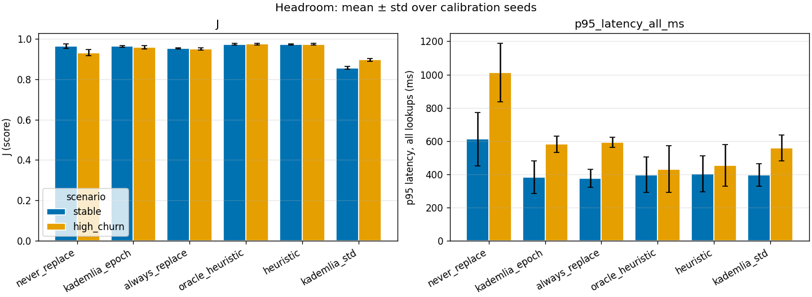
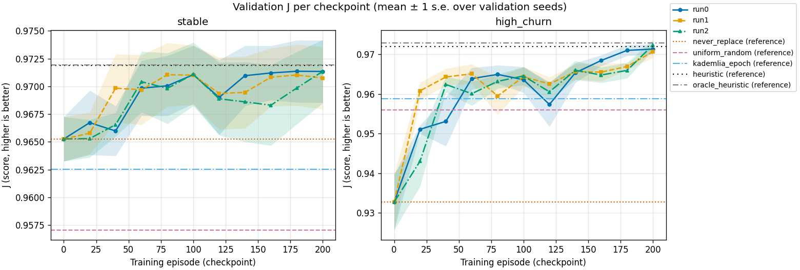
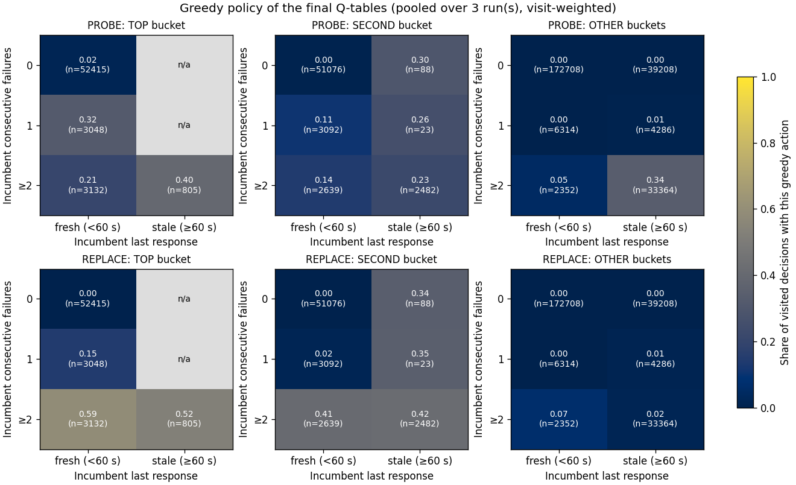
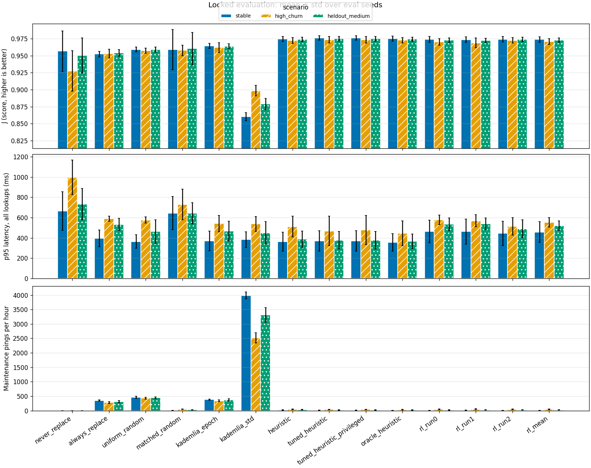
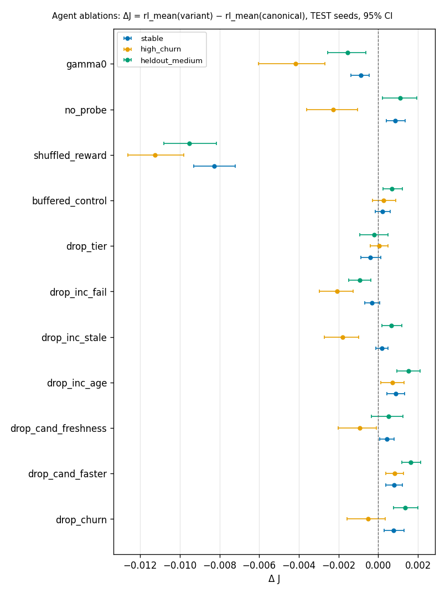
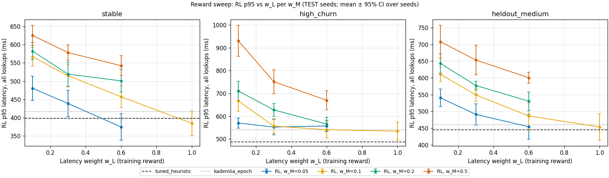
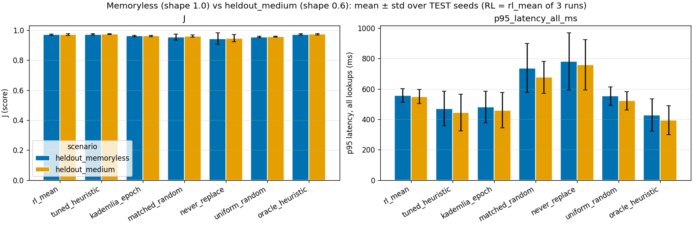

# ChurnMaster: Learning Routing-Table Maintenance for a Kademlia-like DHT under Churn

All numbers in this report come from the artifacts in `results/`. The canonical study artifacts are tracked in Git: `results/{headroom,diagnostics,diagnostics_60,checkpoint_5_17,train,tune,matched,eval,ablations}/` and the report figures and tables in `results/figures/`. Only the verification reruns (`results/reproduce_quick/`, `results/reproduce_full/`) are local; paths marked *(local artifact)* are those, and the command that regenerates each one is given next to it. Sections 1–9 report the pre-registered study and its single locked evaluation. Section 10 reports post-hoc exploratory ablations on separate seeds; they do not change any primary result or hypothesis verdict. Unless stated otherwise, intervals are paired-bootstrap 95% percentile CIs (10,000 resamples) and p-values are Wilcoxon signed-rank.

## 1. Abstract

We train a tabular Q-learning agent to maintain the routing table of one node in a simulated 128-node Kademlia-like DHT under churn. At every 30 s epoch it picks KEEP, PROBE or REPLACE per bucket, using only locally observable information. We evaluate on 20 locked seeds in three scenarios, one of them (heldout_medium) never seen in training or tuning. The learned policy (mean of 3 independent runs) beats Kademlia-style epoch maintenance on the combined score J in every scenario (ΔJ +0.0085 to +0.0097, Holm-adjusted p ≤ 1.7·10⁻⁵) while sending 87–98% fewer pings. It also beats a random policy with matched action frequencies (H1 pass), which shows that the gain comes from targeting decisions, not from acting less. These results hold on the unseen scenario. The learned policy does not match a tuned 32-configuration heuristic, however. It is slightly but significantly worse on J in all three scenarios (ΔJ −0.0020 to −0.0030), and its p95 lookup latency is 18–38% higher than the best baseline's (H3 fail). Non-inferiority hypotheses H2/H4 are inconclusive. The environment leaves little room above the heuristic: even with no maintenance at all, lookup success is ≥98%, and the tuned heuristic already matches or exceeds a ground-truth oracle on J. Separately from this primary evaluation, exploratory ablations on different seeds without multiple-comparison correction (§10) suggest the following. Performance depends on the reward signal. A myopic learner (γ = 0) does worse. Raising the latency weight lowers RL's p95 at the price of more pings, but it does not close the J gap to the tuned heuristic in high_churn. The results barely change under memoryless sessions.

## 2. Problem and research question

Kademlia nodes keep k contacts per XOR-distance bucket. Under churn, contacts die, and a node must decide when to check (ping) a contact and when to swap it for a fresher candidate. Checking costs messages. Not checking leaves dead entries that cause lookup timeouts. Standard Kademlia pings the least-recently-seen contact whenever a newcomer shows up for a full bucket. That is robust but message-heavy.

Research question: can a policy learned with tabular Q-learning, from observable signals only, trade maintenance messages against lookup success and latency better than (a) Kademlia-style maintenance, (b) a random policy with the same action frequencies, and (c) a tuned rule-based heuristic? Does it transfer to an unseen churn level? We pre-registered hypotheses H1–H5 (§7.6) and report them whether they pass or not.

## 3. Simulator

### 3.1 Setup

| parameter | value |
|---|---|
| nodes / ID space | 128 nodes, unique 8-bit IDs (8 buckets for F) |
| bucket size k / lookup parallelism α / replicas | 4 / 2 / 3 closest online nodes |
| replacement cache | 4 per bucket, TTL 300 s |
| lookup | Poisson 1/s, uniform keys; ≤8 rounds, 500 ms timeout, 2000 ms deadline |
| RTT | (10 + 240·dist/√2)·exp(0.25·N(0,1)) ms; ×3 for congested nodes (10% of nodes, ~120 s every ~20 min) |
| packet loss | 2% |
| episode | 600 s warm-up + 2400 s measured; decisions every 30 s |
| other nodes' tables | rebuilt every 300 s (staggered) from online nodes; stale in between |

Churn is modeled per node. Each node is either stable or flaky. It alternates Weibull(shape 0.6) sessions, which are heavy-tailed so that older sessions survive longer, with exponential downtimes, starting from a 2 h burn-in. F is always online.

| scenario | stable share | stable session | flaky session | downtime | used for |
|---|---|---|---|---|---|
| stable | 0.70 | 4 h | 30 min | 20 min | train, tune, eval |
| high_churn | 0.30 | 1 h | 5 min | 10 min | train, tune, eval |
| heldout_medium | 0.45 | 2 h | 10 min | 12 min | eval only (unseen) |
| bursty | 0.50 | 2 h | 15 min | 15 min | configured, not evaluated (Task 11) |

A fifth scenario, heldout_memoryless (heldout_medium with Weibull shape 1.0, i.e. exponential sessions), lives in `configs/ablations/` and is used only by the exploratory §10.3. It is deliberately kept out of `configs/scenarios/`, the directory whose files are frozen into the env manifest, so the canonical pipeline is unchanged.

**Keyed randomness.** All randomness that must be policy-independent comes from a pure hash of the event identity (splitmix64 over root, purpose, and IDs): loss, jitter, background rebuilds, and F's bootstrap. Two policies that send the same ping, keyed by epoch, bucket, destination and kind, get the same outcome. Churn traces and workloads come from per-episode `SeedSequence` streams and are identical across policies (tested via trace and workload hashes).

### 3.2 Limitations

These simplifications bound what the results can claim:

- **Atomic lookups.** A lookup runs to completion at its start time t₀. Every round queries the network state at t₀, and the clock does not advance. Latency is computed (sum of round maxima plus the holder's RTT), not simulated, so churn during a lookup and overlap between concurrent lookups and pings are not modeled. Pings are atomic too.
- **Perfect storage.** The 3 closest online nodes to a key always hold it. There is no replication lag or data loss.
- **Single learner.** Only F adapts. Other nodes use periodically rebuilt, stale tables, so there are no multi-agent dynamics.
- **No adversaries.** No Sybil/eclipse behaviour and no message manipulation.
- **Small success headroom.** Iterative lookups with α=2, 3 replicas, and other nodes' tables are forgiving. With no maintenance at all (never_replace), success is 99.0% in high_churn and ≈100% in stable on calibration seeds (Table 1). Most of the signal is in latency and message cost, not success.

## 4. RL formulation

### 4.1 POMDP framing

The true state (who is online, node types, congestion, other nodes' tables) is hidden. F observes only its own bookkeeping, so the problem is a POMDP. We deliberately treat the discretized observation as if it were the state and run standard tabular Q-learning. Convergence guarantees therefore do not apply, and every claim in this report is empirical. Leakage is prevented structurally. An AST import-guard test forbids `rl/*`, `policies/*` (except `oracle.py`), `sim/routing_table.py` and `sim/observation.py` from importing ground-truth modules. A counterfactual test checks that two different hidden states consistent with the same observation yield the same action for every non-oracle policy. The Ledger accepts only observable record types.

### 4.2 State, actions, masking

Each decision concerns one bucket's least-recently-seen incumbent and its freshest cached candidate. Seven discretized features:

| feature | bins |
|---|---|
| tier | top bucket (b=7) / second (b=6) / other |
| incumbent consecutive failures | 0 / 1 / ≥2 |
| incumbent time since last response | <60 s / ≥60 s |
| incumbent age | <120 s / 120–1200 s / ≥1200 s |
| candidate | none / fresh (<30 s) / stale (30–300 s) |
| candidate faster | candidate RTT < 0.7 × incumbent smoothed RTT |
| churn signal | F's 120 s timeout fraction <0.10 / ≥0.10 |

That gives 3·3·2·3·3·2·2 = 648 indices, of which 540 are reachable ("candidate faster" is impossible without a candidate). Actions: KEEP (0 messages), PROBE (ping the incumbent; on failure, evict it and try the candidate), and REPLACE (ping the candidate and swap it in if it answers). REPLACE is masked when there is no candidate. Empty slots are auto-filled from the cache at no cost.

### 4.3 Reward and score

Per lookup, ℓ = (1 − success) + w_L·min(latency/2000 ms, 1). Each bucket-epoch's reward is the negative sum of the losses of lookups attributed to that bucket in that epoch, minus w_M·pings + w_R·evictions. The weights are **w_L = 0.3, w_M = 0.1, w_R = 0.15**. The cost weights were halved from the original 0.2/0.3 (§6b). The evaluation score is

J = 1 − mean(ℓ) − (w_M·pings + w_R·evictions)/N_lookups = 1 + Σ r / N_lookups,

and this identity holds exactly (tested on every recorded episode: max |error| 3.3·10⁻¹⁶). Standard Kademlia's (kademlia_std) lookup-triggered pings are recorded as cost-only records, so they count in J too.

### 4.4 Q-learning

Q is a 648×3 table initialized to 0. Updates use one-epoch transitions (s_{b,k}, a, r_{b,k}, s_{b,k+1}) per bucket. Transitions that would span an empty bucket or the episode end are dropped. The step size is α_n = max(α_min, (1+n)^−0.7) per (s,a). ε-greedy exploration decays linearly from 1.0 to 0.05 over the first 60% of episodes, and greedy ties break KEEP < PROBE < REPLACE. Each run trains for 200 episodes, alternating stable and high_churn, and learns during warm-up as well. Validation happens every 20 episodes (including episode 0) on 5 validation seeds per training scenario with ε = 0. The final Q-table is used for evaluation.

## 5. Baselines and fairness

| policy | description |
|---|---|
| never_replace | always KEEP (no maintenance) |
| always_replace | REPLACE whenever a candidate exists |
| uniform_random | uniform over allowed actions |
| matched_random | samples actions with the RL policy's own frequencies, split by candidate presence (Table 6) |
| kademlia_epoch | PROBE the incumbent whenever a candidate exists (Kademlia's rule at shared decision points) |
| kademlia_std | real Kademlia: ping the LRS incumbent each time a lookup offers a newcomer to a full bucket |
| heuristic / tuned_heuristic | 4-rule policy (failure threshold f, protect-old, RTT swap, probe-stale, tier gate) = 32 configs; default config vs global best on train seeds |
| tuned_heuristic_privileged | per-scenario best config (sees the test scenario during tuning) |
| oracle_heuristic | ground-truth reference: REPLACE/PROBE only if the incumbent is truly offline |

Fairness rules. All epoch-mode policies get identical churn traces, workloads, decision times and keyed loss/jitter outcomes (tests in `tests/test_fairness.py`). **kademlia_std does not share decision points.** It acts after lookups rather than at epochs, because that is what the real protocol does, and it is labeled "no-dp" in all tables. Every heuristic config is exactly representable as a 540-state lookup table, so the learner's hypothesis class contains every heuristic. Tuning effort favors the heuristic: 32 configs on 10 train seeds per scenario, versus 4 grid settings (γ × α_min) for RL. **The oracle is a reference, not an upper bound.** It ignores latency (it never swaps a live but slow contact) and candidate quality, so other policies can beat it on J, and the tuned heuristic does.

## 6. Methodology and protocol deviations

All deviations were decided before the locked evaluation was run. In chronological order:

a. **Headroom gates redefined (after checkpoint 5.17, user decision).** The original gates required a success-rate gain in percentage points over never_replace. In the checkpoint run (`results/checkpoint_5_17/`, from the pre-gate checkpoint and not regenerated by any current command; the figures quoted here and in (b) are all that is used), never_replace already reached 98.99% success in high_churn, and the best policy (oracle, 99.87%) gained under 1 pp, so success-based gates could not discriminate. The gates were changed to J or p95 latency. G1: in high_churn, the best of {kademlia_epoch, always_replace, oracle} beats never_replace with ΔJ ≥ 0.01 and CI lo > 0, or with ≥20% p95 reduction and CI lo > 0. G2: oracle beats kademlia_epoch with ΔJ ≥ 0.01, or uses ≤60% of its pings at ΔJ ≥ −0.005.

b. **Maintenance cost weights halved (after reward diagnostics, user decision).** The weights went from w_M 0.2 / w_R 0.3 to 0.1 / 0.15. The checkpoint-5.17 summary, whose non-J metrics are identical to the final headroom run and whose J differs only for policies that send messages (we infer it used the original weights), shows the problem: in high_churn, always_replace scored J 0.9295, *below* never_replace's 0.9310, and kademlia_epoch was only 0.9475. Maintenance was priced so high that it barely paid off. The headroom gates were re-run with the new weights. The env hash excludes reward settings, so the frozen environment was unchanged.

c. **Diagnostics re-run with 60 episodes.** At the official 20 episodes, the reward-sanity test for dead incumbents lacked power (§7.2). It was re-run with 60 episodes per scenario (`results/diagnostics_60/`; regenerate with `diagnostics --episodes 60 --out results/diagnostics_60`). Coverage is still reported from the official 20-episode run.

d. **Privileged heuristic fallback.** heldout_medium has no tuning data by design, so `tuned_heuristic_privileged` falls back to the global config there (tag "priv*"; recorded as `privileged_fallback` in the eval manifest).

e. **H3 "best baseline" excludes oracle_heuristic and tuned_heuristic_privileged.** One uses ground truth and the other sees test-scenario tuning data. This was decided and written into the eval config (`h3_exclude_from_best`) before the eval results were seen.

f. **Single-use eval lock.** The 20 eval seeds per scenario (run 0, episodes 0–19, root seed 20240601) were locked with `evaluate --create-lock` and checked against 635 other seed states (calibration, train, tuning, validation) for overlap: none. The canonical evaluation ran once (`prior_eval_runs: 0`).

g. **I4 reference (interpretation).** Under greedy tie-breaking, the untrained episode-0 checkpoint is all-KEEP, i.e. never_replace. The untrained agent's actual episode-0 behaviour (ε = 1) is uniform_random. I4 uses uniform_random as the primary reference and reports both.

## 7. Results

### 7.1 Headroom (calibration, 10 seeds)

**Table 1.** Calibration means (final reward weights).

| scenario | policy | success | p95 all (ms) | pings/h | J |
|---|---|---|---|---|---|
| stable | never_replace | 0.9998 | 612.5 | 0 | 0.9623 |
| stable | kademlia_epoch | 1.0000 | 382.4 | 411.9 | 0.9622 |
| stable | always_replace | 1.0000 | 375.5 | 365.85 | 0.9509 |
| stable | oracle_heuristic | 1.0000 | 397.3 | 8.85 | 0.9727 |
| high_churn | never_replace | 0.9899 | 1012.4 | 0 | 0.9310 |
| high_churn | kademlia_epoch | 0.9951 | 580.8 | 352.95 | 0.9584 |
| high_churn | always_replace | 0.9946 | 592.6 | 292.05 | 0.9492 |
| high_churn | oracle_heuristic | 0.9987 | 431.4 | 33.15 | 0.9733 |
| high_churn | kademlia_std (no-dp) | 0.9951 | 559.2 | 2526.9 | 0.8954 |

Both gates pass on the J route (`results/figures/tables/headroom_gates.md`; source `results/headroom/gates.json`, written by `headroom`). G1's best candidate is the oracle: ΔJ vs never_replace +0.0424 [+0.0342, +0.0502], p95 reduced by 581.0 ms (57.2%). kademlia_epoch (+0.0274 [+0.0204, +0.0344]) and always_replace (+0.0182 [+0.0105, +0.0256]) pass on their own as well. G2: oracle − kademlia_epoch ΔJ +0.0150 [+0.0119, +0.0188] at a ping ratio of 0.094 (33.15 vs 352.95 pings/h). No G1 fallback tuning was needed. The env hashes for all four scenarios were frozen. See `../results/figures/headroom_J_p95.png`.

### 7.2 Reward diagnostics (uniform_random behaviour, calibration seeds)

- **Identity:** holds on all 40 (20-ep) and 120 (60-ep) episodes; max |ΔJ| 3.3·10⁻¹⁶.
- **Coverage (official, 20 episodes/scenario):** 90.7% of 23,634 decisions fall in states visited ≥50 times (high_churn 81.8%, stable 92.3%; target 80%). Pass. See `../results/figures/diagnostics_state_visits.png`.
- **Reward sanity** (10-epoch discounted return, γ = 0.9; Table 2). Live incumbents: KEEP > REPLACE everywhere. Dead top/second-tier incumbents: the PROBE-vs-KEEP comparison is underpowered at 20 episodes. At 60 episodes, all comparisons pass in high_churn and pooled. In stable, PROBE vs KEEP still includes 0 (only 102/85 dead-incumbent samples), so the overall reward-sanity flag stays **false**.
- **J vs success Spearman** (headroom per-seed table): pooled ρ = 0.267 (p = 0.0032, n = 120); high_churn ρ = 0.601 (p = 3.8·10⁻⁷); stable ρ = −0.163 (p = 0.21). In stable, success is saturated, so J is driven by latency and cost.

**Table 2.** Reward-sanity return differences (better − worse) with 95% CI.

| comparison | 20 ep, pooled | 60 ep, high_churn | 60 ep, stable | 60 ep, pooled |
|---|---|---|---|---|
| dead top2: PROBE − KEEP | +0.186 [−0.135, +0.505] | +0.236 [+0.046, +0.428] | +0.245 [−0.059, +0.547] | +0.240 [+0.071, +0.407] |
| dead top2: REPLACE − KEEP | +0.421 [+0.109, +0.738] | +0.472 [+0.283, +0.658] | +0.491 [+0.175, +0.808] | +0.477 [+0.313, +0.638] |
| live: KEEP − REPLACE | +0.220 [+0.158, +0.284] | +0.201 [+0.141, +0.262] | +0.199 [+0.155, +0.241] | +0.200 [+0.164, +0.235] |

### 7.3 Training

A debug run (high_churn, 1 × 100 episodes, γ 0.9, α_min 0.05) passed its I4 check. The grid then selected **γ = 0.8, α_min = 0.02** by mean validation J over checkpoints 160–200 (Table 3). Note that this differs from the design default γ = 0.9.

**Table 3.** Hyperparameter grid (1 run each, 200 episodes).

| γ | α_min | score (last 3 ckpts) | stable | high_churn | final J |
|---|---|---|---|---|---|
| **0.8** | **0.02** | **0.97079** | 0.97130 | 0.97029 | 0.97135 |
| 0.8 | 0.05 | 0.97075 | 0.97142 | 0.97008 | 0.97095 |
| 0.9 | 0.02 | 0.97037 | 0.97075 | 0.97000 | 0.97058 |
| 0.9 | 0.05 | 0.96863 | 0.97006 | 0.96721 | 0.96982 |

The four settings lie within 0.0022 of each other. The three final runs all pass I4 (Table 4). Each beats the untrained agent's actual behaviour (uniform_random) and the all-KEEP episode-0 checkpoint with CIs excluding 0, and mean |ΔQ| shrinks by roughly 10× between the first and last 20-episode windows.

**Table 4.** I4 per run (validation, n = 10 = 5 seeds × 2 scenarios).

| run | ΔJ vs uniform_random | ΔJ vs checkpoint 0 (never_replace) | mean \|ΔQ\| ep 0–20 → 180–200 | final val. J (stable / high_churn) |
|---|---|---|---|---|
| 0 | +0.0148 [+0.0130, +0.0164] | +0.0224 [+0.0109, +0.0354] | 0.0362 → 0.0027 | 0.9713 / 0.9714 |
| 1 | +0.0142 [+0.0121, +0.0158] | +0.0218 [+0.0104, +0.0347] | 0.0350 → 0.0035 | 0.9708 / 0.9707 |
| 2 | +0.0154 [+0.0133, +0.0170] | +0.0229 [+0.0112, +0.0362] | 0.0302 → 0.0030 | 0.9713 / 0.9724 |

The validation curves (`../results/figures/validation_curves.png`; per-episode training curves are in `../results/figures/training_curves.png`) show high_churn J rising from 0.933 at checkpoint 0 to about 0.971 by checkpoint 200, close to the default heuristic and oracle reference lines. In stable the gain is smaller (0.965 → 0.971) because there is less to fix. The learned greedy policies visit 352 / 337 / 349 of the 540 reachable states and are KEEP-dominated: visit-weighted KEEP share is 95.4% / 93.4% / 93.8%. The pooled heatmap (`../results/figures/greedy_policy_heatmap.png`) shows a sensible structure. For top-bucket incumbents with ≥2 failures, the greedy action is REPLACE in 59% (fresh last response) and 52% (stale) of visited decisions. For incumbents with 0 failures and a fresh response, the agent almost never acts (PROBE ≤ 2%, REPLACE 0%). In "other" buckets, the agent acts much less, even after ≥2 failures (REPLACE 2–7%).

### 7.4 Heuristic tuning and matched frequencies

All 32 configs were run on 10 train seeds per training scenario (640 jobs). The global best is `f=2, protect_old=0, rtt_swap=1, probe_stale=0, tier_gate=all`: replace after 2 failures and swap in fresh, faster candidates for young incumbents. The default config ranks 22nd (Table 5; `../results/figures/tuning_scatter.png`). The top configs differ in J by ≤0.0001, so the heuristic family is flat near its optimum.

**Table 5.** Tuning, top 5 of 32 and the default (train seeds).

| rank | config | J overall | J stable | J high_churn | p95 (ms) | pings/h |
|---|---|---|---|---|---|---|
| 1 | f=2,po=0,rs=1,ps=0,tg=all (global; privileged stable) | 0.9752 | 0.9761 | 0.9742 | 395.2 | 23.5 |
| 2 | f=2,po=1,rs=1,ps=0,tg=all | 0.9752 | 0.9761 | 0.9742 | 395.2 | 23.5 |
| 3 | f=2,po=0,rs=1,ps=0,tg=top_two (privileged high_churn) | 0.9751 | 0.9760 | 0.9742 | 394.7 | 22.9 |
| 4 | f=2,po=1,rs=1,ps=0,tg=top_two | 0.9751 | 0.9760 | 0.9742 | 394.7 | 22.9 |
| 5 | f=2,po=0,rs=1,ps=1,tg=top_two | 0.9751 | 0.9759 | 0.9742 | 395.5 | 23.5 |
| 22 | f=2,po=1,rs=0,ps=1,tg=all (default) | 0.9740 | 0.9743 | 0.9738 | 400.3 | 33.5 |

**Table 6.** RL action frequencies used by matched_random (validation seeds, 3 runs pooled, KEEP/PROBE/REPLACE).

| scenario | with candidate | without candidate |
|---|---|---|
| stable | 98.5% / 0.7% / 0.7% | 99.6% / 0.4% / 0% |
| high_churn | 92.6% / 3.9% / 3.5% | 96.3% / 3.7% / 0% |
| heldout_medium | 95.6% / 1.7% / 2.8% | 98.6% / 1.4% / 0% |

### 7.5 Locked evaluation (20 eval seeds × 3 scenarios, 780 jobs)

**Table 7.** Selected policies (mean ± std over seeds; rl_mean = per-seed average of the 3 runs). Full table: `results/figures/tables/eval_summary.md`.

| scenario | policy | J | success | p95 all (ms) | pings/h | evictions/h |
|---|---|---|---|---|---|---|
| stable | never_replace | 0.9566 ± 0.0297 | 0.9952 | 663.4 | 0 | 0 |
| stable | kademlia_epoch | 0.9642 ± 0.0036 | 1.0000 | 371.3 | 383.9 | 14.5 |
| stable | kademlia_std (no-dp) | 0.8604 ± 0.0061 | 1.0000 | 382.9 | 3983.3 | 83.5 |
| stable | matched_random | 0.9589 ± 0.0294 | 0.9954 | 643.6 | 8.03 | 3.90 |
| stable | tuned_heuristic | **0.9760** ± 0.0031 | 1.0000 | 371.3 | 9.30 | 8.70 |
| stable | oracle_heuristic (ref) | 0.9751 ± 0.0037 | 1.0000 | 354.3 | 7.28 | 7.28 |
| stable | rl_mean | 0.9739 ± 0.0040 | 1.0000 | 456.6 | 7.13 | 4.83 |
| high_churn | never_replace | 0.9276 ± 0.0296 | 0.9833 | 996.6 | 0 | 0 |
| high_churn | kademlia_epoch | 0.9619 ± 0.0071 | 0.9966 | 540.9 | 338.0 | 29.6 |
| high_churn | kademlia_std (no-dp) | 0.8986 ± 0.0078 | 0.9965 | 537.6 | 2519.5 | 73.6 |
| high_churn | matched_random | 0.9578 ± 0.0078 | 0.9969 | 729.6 | 48.3 | 23.3 |
| high_churn | tuned_heuristic | **0.9735** ± 0.0050 | 0.9984 | 468.4 | 38.5 | 36.4 |
| high_churn | oracle_heuristic (ref) | 0.9727 ± 0.0042 | 0.9983 | 446.3 | 35.1 | 33.5 |
| high_churn | rl_mean | 0.9705 ± 0.0043 | 0.9979 | 553.8 | 43.8 | 30.8 |
| heldout_medium | never_replace | 0.9505 ± 0.0256 | 0.9939 | 733.1 | 0 | 0 |
| heldout_medium | kademlia_epoch | 0.9640 ± 0.0034 | 0.9996 | 466.4 | 368.7 | 20.9 |
| heldout_medium | kademlia_std (no-dp) | 0.8791 ± 0.0084 | 0.9996 | 450.5 | 3313.1 | 81.5 |
| heldout_medium | matched_random | 0.9603 ± 0.0239 | 0.9943 | 643.7 | 26.1 | 15.4 |
| heldout_medium | tuned_heuristic | **0.9749** ± 0.0034 | 0.9996 | 378.7 | 20.4 | 19.4 |
| heldout_medium | oracle_heuristic (ref) | 0.9742 ± 0.0031 | 0.9997 | 366.8 | 19.1 | 18.4 |
| heldout_medium | rl_mean | 0.9729 ± 0.0032 | 0.9996 | 521.3 | 22.6 | 16.9 |

Per-scenario success-vs-pings scatters: `../results/figures/eval_success_vs_pings_stable.png`, `../results/figures/eval_success_vs_pings_high_churn.png`, `../results/figures/eval_success_vs_pings_heldout_medium.png`.

**Table 8.** The 9 primary tests (rl_mean − comparator on J, paired over 20 seeds, Holm over the family).

| scenario | comparator | ΔJ | 95% CI | p | p_Holm |
|---|---|---|---|---|---|
| stable | kademlia_epoch | +0.0097 | [+0.0091, +0.0102] | 1.9e-06 | 1.7e-05 |
| stable | tuned_heuristic | −0.0021 | [−0.0030, −0.0013] | 6.3e-05 | 1.9e-04 |
| stable | matched_random | +0.0149 | [+0.0061, +0.0295] | 9.5e-06 | 3.8e-05 |
| high_churn | kademlia_epoch | +0.0085 | [+0.0065, +0.0110] | 1.9e-06 | 1.7e-05 |
| high_churn | tuned_heuristic | −0.0030 | [−0.0044, −0.0017] | 4.8e-04 | 4.8e-04 |
| high_churn | matched_random | +0.0127 | [+0.0100, +0.0160] | 1.9e-06 | 1.7e-05 |
| heldout_medium | kademlia_epoch | +0.0089 | [+0.0081, +0.0098] | 1.9e-06 | 1.7e-05 |
| heldout_medium | tuned_heuristic | −0.0020 | [−0.0027, −0.0013] | 6.3e-05 | 1.9e-04 |
| heldout_medium | matched_random | +0.0126 | [+0.0053, +0.0235] | 3.8e-06 | 1.9e-05 |

All 9 tests are significant after Holm correction: 6 in RL's favour and 3 against it. RL sends 98.1% (stable), 87.1% (high_churn) and 93.9% (heldout_medium) fewer pings than kademlia_epoch. Its paired ping differences are −376.8, −294.2 and −346.1 pings/h. Paired success differences are tiny: |Δ| ≤ 0.2 pp in every per-run comparison against kademlia_epoch and the tuned heuristic.

**Per-run consistency** (`results/eval/per_run.csv`; `reproduce --full` regenerates it as `OUT/eval/per_run.csv`). Every run individually beats kademlia_epoch and matched_random on J in every scenario, with CIs excluding 0. Against the tuned heuristic, all 9 per-run differences are negative. 8 have CIs excluding 0. The exception is run 2 in high_churn: −0.0010 [−0.0025, +0.0004], p = 0.19. On p95 vs kademlia_epoch, three cells are not significantly different: run 2 in high_churn (−27.1 ms [−76.5, +25.2]), run 2 in heldout_medium (+23.8 ms [−10.8, +59.1]), and run 1 in high_churn (+27.6 ms [−3.3, +64.2]). The other six run × scenario cells are 38.2–91.6 ms slower, with CIs excluding 0.

### 7.6 Hypotheses

**Table 9.** H1–H5 (generated automatically by `experiments/stats.py`).

| id | statement | verdict | key evidence |
|---|---|---|---|
| H1 | RL > matched_random on J in every scenario (Holm) | **pass** | ΔJ +0.0149 / +0.0127 / +0.0126, p_Holm ≤ 3.8e-05 |
| H2 | high_churn: RL non-inferior (within 1 pp success) to kademlia_epoch and tuned_heuristic, and significantly better on ≥1 primary metric | **inconclusive** | vs kademlia_epoch: Δsuccess +0.0013 [−0.0004, +0.0035], better on pings/h (pass). vs tuned_heuristic: Δsuccess −0.0005 [−0.0016, +0.0005], better on none |
| H3 | RL pings ≤ kademlia_epoch and p95 within 5% of the best baseline, every scenario | **fail** | pings condition holds everywhere. p95 ratio vs best baseline: stable 456.6/362.0 (default heuristic) = 1.261; high_churn 553.8/468.4 (tuned) = 1.182; heldout 521.3/378.7 (tuned) = 1.377 |
| H4 | H2 holds on heldout_medium | **inconclusive** | same pattern: non-inferior to both, better than kademlia_epoch on pings, better than the tuned heuristic on nothing |
| H5 | all 3 runs individually in H2's direction (high_churn) | **pass** | vs kademlia_epoch: +0.0082 / +0.0069 / +0.0105. vs tuned_heuristic: −0.0033 / −0.0047 / −0.0010 |

H5's "pass" means the runs agree in sign with the pooled result. Against the tuned heuristic, they agree that RL is *worse*. The "inconclusive" verdicts on H2/H4 come from the half of each hypothesis that compares RL with the tuned heuristic. RL is non-inferior on success but better on no metric, and Table 8 shows it is significantly worse on J. Read substantively, the tuned-heuristic comparison is a negative result.

## 8. Discussion

**What RL learned.** The agent learned a frugal policy: act on repeated failures in the buckets that matter most, and otherwise KEEP. This places it in the same low-message regime as the heuristic and the oracle (7–44 pings/h versus 338–384 for kademlia_epoch and 2,500–4,000 for kademlia_std). Within that regime it is much better than chance. matched_random has the same action frequencies (93–99% KEEP), but its p95 (643.6–729.6 ms) is the worst of any epoch-mode policy except never_replace, and its seed variance is large. RL beats it by ΔJ ≈ 0.013–0.015, so the learned state→action mapping carries real information. The result transfers to heldout_medium with effect sizes similar to the training scenarios.

**Why RL trails the tuned heuristic.** We see four contributing explanations. The locked evaluation cannot separate them. The exploratory ablations in §10 probe 1–3 on separate seeds, without multiple-comparison correction. They narrow the picture but do not establish any single cause.

1. *Light latency weight.* With w_L = 0.3, slowing one lookup from 300 ms to 600 ms adds only 0.045 to its loss, while one successful REPLACE costs 0.1 + 0.15 = 0.25. The tuned heuristic relies on the RTT swap rule (rs=1 in all top-5 configs; the default, with rs=0, ranks 22nd), which replaces live but slow contacts. Under this reward, the reward-sanity diagnostic finds that KEEP beats REPLACE for live incumbents on average (+0.200 return). The RL p95 gap (18–38%) is consistent with the agent rarely making latency-motivated swaps. *Exploratory follow-up (§10.2):* retraining with a higher w_L, still scored under the canonical weights, moved RL's p95 in the predicted direction. At w_M = 0.1, p95 fell monotonically with w_L in all three scenarios (4 points, descriptive only). Going from w_L = 0.3 to 1.0 changed p95 by −130.5 / −22.2 / −95.6 ms (stable / high_churn / heldout_medium), with uncorrected CIs excluding 0. The cost was 74–100 instead of 8–44 pings/h. The p95 gap to the tuned heuristic narrowed, but in high_churn it stayed positive (+47.7 ms [+9.5, +92.9]). RL's J stayed below the tuned heuristic's in every cell and scenario except one: w_L 0.6 / w_M 0.05 on stable, which was picked post hoc out of 36 cell-scenario combinations. So the latency weight plausibly accounts for part of the p95 gap. It does not account for the J gap in high_churn.
2. *Coarse, aliased state.* One bit of "candidate faster" and three age bins pool very different situations. Since this is a POMDP, aliased states average over hidden outcomes, and the greedy policy often splits (e.g. 41–59% REPLACE in some cells), which suggests near-ties. *Exploratory follow-up (§10.1):* removing single features did not hurt as this explanation would predict. Dropping incumbent age, candidate-faster or the churn signal gave small J gains (+0.0007 to +0.0016 in most scenarios) and lower p95. Dropping the failure count hurt in high_churn (−0.0021). Finer state does not look like the bottleneck for those features. This is consistent with explanation 3 (limited data per state), but it was not tested directly.
3. *Sparse, noisy credit.* Per-bucket rewards sum a handful of lookups per 30 s epoch, and success is ~99% even without maintenance, so the signal per transition is small next to noise. The 20-episode reward-sanity check could not separate PROBE from KEEP for dead incumbents. It took 60 episodes in high_churn, and even then stable was inconclusive.
4. *Little headroom above heuristics.* The tuned heuristic already matches or beats the ground-truth oracle on J in all three scenarios (0.9760 vs 0.9751, 0.9735 vs 0.9727, 0.9749 vs 0.9742). The learnable margin above it is small, and the RL gap (0.002–0.003) is of the same order as the differences between heuristic configs.

**Negative and inconclusive results.** H3 fails on latency in every scenario. H2/H4 cannot claim non-inferiority-plus-improvement against the tuned heuristic. We report these as findings. In this environment, a tabular learner with 4 hyperparameter settings did not outperform a well-tuned 32-config rule family, although it clearly beat the standard protocol and frequency-matched random play.

**Threats to validity.**
- *Internal:* atomic lookups and pings understate the cost of dead entries under concurrent churn. kademlia_std is not decision-point matched. The reward-sanity diagnostic did not fully pass (stable, dead-incumbent PROBE vs KEEP). Two protocol changes (gates, weights) were made after looking at calibration and diagnostic data, though before any training or evaluation.
- *Statistical:* n = 20 seeds per scenario. Holm covers only the 9 J tests; H2–H5 secondary comparisons are uncorrected. The §10 ablations add several hundred further uncorrected comparisons on TEST seeds, so some of their individually small effects are expected to be false positives. matched_random's CIs are wide because of a few poor seeds (std 0.0294 in stable).
- *External:* 128 nodes and 8-bit IDs give only 8 buckets. Churn is independent per node (bursty was not evaluated). There is a single learner and no adversaries.
- *Tuning asymmetry:* the heuristic had 32 configs, RL 4 grid points. The exploratory reward sweep (§10.2; 12 weight cells × 3 runs, scored on TEST seeds) shows that other training weights change RL's latency/ping trade-off. It found no cell that closes the high_churn J gap.

## 9. Reproducibility

- Commands: see the README. The canonical order is headroom → diagnostics → train (debug, grid, final) → tune → `python -m churnmaster.experiments.matched` → `evaluate --create-lock` → `evaluate` → `reproduce --figures-only`.
- Determinism: keyed hashing for policy-independent randomness, `SeedSequence` splits for everything else, a frozen env manifest (hashes for all 4 scenarios), and a single-use eval lock (seed-list hash `d25792a4…`). Results are identical for any worker count.
- Verification: `reproduce --full` (659 s total on the reference machine, 8 workers; the training stage took 423 s) regenerated the whole pipeline in `results/reproduce_full/` (*local artifact*; rerun with `reproduce --full`, optionally `--out DIR`). Its `eval/per_seed.csv` is byte-identical to the canonical one (SHA-256 equal; 780 rows, max |diff| 0 in every metric column), and the grid and tuning selections match. `reproduce --quick` finishes in 100 s. With 5 eval seeds it is a smoke test, not a result (for example, H1 is inconclusive there).
- Version history (commit log): v0.1.0 simulator, maintenance and baselines; v0.2.0 headroom gate, env freeze, ledger and diagnostics; the cost-weight halving; v0.3.0 Q-learning and training; heuristic tuning, matched_random and statistics; v0.4.0 locked evaluation and H1–H5; then the two `reproduce` commits; v1.0.0 README, report and final checkpoint (commit `2f997a0`); v1.1.0 tracked figures and the exploratory ablations of §10. The repository is tagged v0.1.0, v0.2.0, v0.2.1, v0.3.0, v0.4.0, v1.0.0 and v1.1.0. The ablation commits did not regenerate or modify any canonical result. The canonical evaluation was produced at commit `2af8117` and the full reproduction at `cc66bd4`.
- Environment: Python 3.11.9, numpy 2.1.3, scipy 1.14.1, pandas 2.2.3, matplotlib 3.9.2, pytest 8.3.3, hypothesis 6.115.0 (recorded in every manifest).

## 10. Exploratory ablations (Task 12; not part of the locked evaluation)

> **Scope.** Everything in this section is exploratory and post hoc. It was run after the locked evaluation on the **TEST split (run 0, episodes 0–19)**. These seeds are disjoint from the 20 eval seeds and from every calibration, train, tuning and validation seed (checked in each suite). No result here changes Table 8, Table 9 or any hypothesis verdict. Intervals are 95% paired-bootstrap CIs over 20 seeds. p-values are Wilcoxon signed-rank and **not corrected for multiple comparisons**, and the three suites together make several hundred comparisons. "CI excludes 0" here is a descriptive flag, not a significance claim. Each suite's analysis plan was written before it ran and is recorded in `results/ablations/manifest.json`. Full tables are tracked in `results/figures/ablations/tables/` and regenerated with `python -m churnmaster ablate --suite agent|reward|memoryless`, then `python scripts/export_ablation_assets.py`. All RL numbers are rl_mean, the per-seed mean of 3 independent training runs.

On these TEST seeds the canonical policy reproduces the primary pattern. Its J is 0.9708 / 0.9699 / 0.9710 (stable / high_churn / heldout_medium), against 0.9739 / 0.9724 / 0.9741 for the tuned heuristic, i.e. ΔJ −0.0031 / −0.0025 / −0.0031.

### 10.1 Agent ablations (Task 12.1)

Each variant is retrained (3 runs × 200 episodes, canonical weights and hyperparameters) and compared with the canonical rl_mean on the same seeds.

**Table 10.** Selected agent ablations, ΔJ vs canonical [95% CI] (stable / high_churn / heldout_medium). Full table with p95, pings and the comparison with the tuned heuristic: `results/figures/ablations/tables/agent_ablations.md`.

| variant | what changes | stable | high_churn | heldout_medium |
|---|---|---|---|---|
| buffered_control | Q updates deferred to episode end, rewards not permuted | +0.0002 [−0.0002, +0.0006] | +0.0003 [−0.0003, +0.0009] | +0.0007 [+0.0002, +0.0012] |
| shuffled_reward | as buffered_control, but rewards permuted across the episode's transitions | −0.0083 [−0.0093, −0.0072] | −0.0113 [−0.0126, −0.0098] | −0.0095 [−0.0108, −0.0082] |
| gamma0 | γ = 0 (myopic) | −0.0009 [−0.0014, −0.0005] | −0.0042 [−0.0060, −0.0027] | −0.0015 [−0.0026, −0.0006] |
| no_probe | PROBE masked in training and evaluation | +0.0008 [+0.0004, +0.0014] | −0.0023 [−0.0036, −0.0010] | +0.0011 [+0.0002, +0.0019] |
| drop_inc_fail | failure-count feature removed | −0.0003 [−0.0007, +0.0001] | −0.0021 [−0.0030, −0.0013] | −0.0009 [−0.0015, −0.0004] |
| drop_inc_age | incumbent-age feature removed | +0.0009 [+0.0004, +0.0013] | +0.0007 [+0.0001, +0.0013] | +0.0015 [+0.0009, +0.0021] |
| drop_cand_faster | candidate-faster bit removed | +0.0008 [+0.0004, +0.0012] | +0.0008 [+0.0004, +0.0013] | +0.0016 [+0.0012, +0.0021] |
| drop_churn | churn-signal feature removed | +0.0008 [+0.0003, +0.0013] | −0.0005 [−0.0016, +0.0004] | +0.0014 [+0.0008, +0.0020] |

- **Reward signal.** shuffled_reward against its own buffered_control: ΔJ −0.0085 / −0.0115 / −0.0102. The shuffled agent also sends +321 to +397 pings/h relative to canonical. buffered_control is indistinguishable from canonical in two scenarios. So the learned behaviour depends on rewards being aligned with their transitions, not on the buffering procedure. This is an intervention within this setup. It says nothing about which reward components matter.
- **Multi-epoch credit.** γ = 0 is worse in all three scenarios, most clearly in high_churn (−0.0042, p95 +48.5 ms [+22.2, +82.1]).
- **PROBE and failure count.** Masking PROBE or removing the failure count hurts in high_churn (−0.0023, −0.0021). no_probe is slightly better in stable and heldout_medium.
- **Features that did not help.** Removing incumbent age, candidate-faster, or (in two scenarios) the churn signal gave small J gains and lower p95 (−26 to −79 ms where the CI excludes 0). See §8, explanation 2.
- **No variant reaches the tuned heuristic.** Every variant × scenario ΔJ vs tuned_heuristic is negative, with a CI excluding 0. The closest is drop_cand_faster on heldout_medium: −0.0015 [−0.0024, −0.0006].

Per-metric view: [`agent_ablation_metrics.png`](../results/figures/ablations/agent_ablation_metrics.png).

### 10.2 Reward-weight sweep (Task 12.2)

Training weights vary over w_L ∈ {0.1, 0.3, 0.6} × w_M ∈ {0.05, 0.1, 0.2, 0.5}, plus w_L = 1.0 at w_M = 0.1, with w_R = 1.5·w_M throughout. That makes 12 non-canonical cells, each trained 3 runs × 200 episodes (36 trainings). **Every policy is scored under the canonical weights** (w_L 0.3, w_M 0.1, w_R 0.15), so all J values are comparable with the rest of the report. The tuned heuristic is the canonical one (tuned for exactly this score).

**Table 11.** The w_M = 0.1 line (rl_mean on TEST seeds; Δp95 vs canonical [95% CI]; stable / high_churn / heldout_medium). Full 13-cell table: `results/figures/ablations/tables/reward_sweep.md`.

| w_L | p95 (ms) | Δp95 vs canonical | pings/h | ΔJ vs tuned heuristic |
|---|---|---|---|---|
| 0.1 | 566 / 667 / 611 | +51.6 [+36.3, +68.1] / +110.4 [+68.9, +155.6] / +61.4 [+36.1, +91.5] | 5.0 / 27.9 / 14.2 | −0.0047 / −0.0081 / −0.0070 |
| 0.3 (canonical) | 515 / 556 / 549 | – | 8.5 / 44.3 / 20.0 | −0.0031 / −0.0025 / −0.0031 |
| 0.6 | 457 / 541 / 486 | −57.8 [−84.2, −34.4] / −15.7 [−36.9, +1.2] / −63.0 [−93.7, −34.6] | 32.0 / 67.7 / 40.6 | −0.0027 / −0.0031 / −0.0022 |
| 1.0 | 384 / 534 / 454 | −130.5 [−162.5, −99.3] / −22.2 [−46.5, −5.1] / −95.6 [−130.6, −63.9] | 73.7 / 99.7 / 84.7 | −0.0012 / −0.0029 / −0.0021 |

- **Latency weight → p95.** Along w_M = 0.1, RL p95 decreases monotonically with w_L in every scenario (Spearman ρ = −1.00 over n = 4 points; descriptive only). The effect is large in stable and heldout_medium and small in high_churn. It comes with more pings (about 9× canonical in stable at w_L = 1.0). In high_churn the p95 gap to the tuned heuristic remains at w_L = 1.0: +47.7 ms [+9.5, +92.9].
- **J gap.** Only one cell × scenario has ΔJ vs tuned with a CI above 0: w_L 0.6 / w_M 0.05 on stable, +0.0013 [+0.0005, +0.0021]. It was found by looking across 36 cell × scenario combinations on the same TEST seeds, so it is subject to selection, and it has not been validated on independent seeds. Two more cells have CIs that include 0 (w_L 0.3 / w_M 0.05 on stable; w_L 0.6 / w_M 0.05 on heldout_medium). In high_churn every non-canonical cell is at least 0.0029 below the tuned heuristic.
- **Heavy maintenance cost hurts.** w_M = 0.5 drives pings to 1.4–13.4 per hour and lowers J in every scenario, by up to −0.0285 (w_L 0.1, high_churn).

Also: [`reward_sweep_J.png`](../results/figures/ablations/reward_sweep_J.png), [`reward_sweep_tradeoff.png`](../results/figures/ablations/reward_sweep_tradeoff.png).

### 10.3 Memoryless held-out scenario (Task 12.3)

heldout_memoryless is heldout_medium with Weibull shape 1.0 instead of 0.6 (`configs/ablations/heldout_memoryless.toml`). The Weibull scale is mean/Γ(1 + 1/shape), so mean session lengths and the online fraction are unchanged. Only the hazard shape changes, which means an incumbent's age carries no information about its remaining session. The suite checks that the scenario differs from the frozen heldout_medium env *only* in name and shape, and records its own hashes in the ablations manifest. The frozen env manifest is not modified. The canonical policies are evaluated without retraining or re-tuning. Both scenarios run on the same TEST seeds, so differences are paired by episode, although the churn draws differ. matched_random frequencies for the new scenario are measured with the task 9.2 procedure (canonical RL on 5 VALIDATION episodes).

**Table 12.** Memoryless vs heldout_medium (TEST seeds; full table `results/figures/ablations/tables/memoryless.md`).

| policy | J memoryless | J heldout_medium | ΔJ (shape effect) [95% CI] | p95 memoryless (ms) | p95 heldout_medium (ms) |
|---|---|---|---|---|---|
| rl_mean | 0.9700 | 0.9710 | −0.0009 [−0.0018, −0.0000] | 557 | 549 |
| tuned_heuristic | 0.9725 | 0.9741 | −0.0017 [−0.0024, −0.0008] | 471 | 445 |
| oracle_heuristic (ref) | 0.9724 | 0.9733 | −0.0009 [−0.0019, +0.0002] | 428 | 395 |
| kademlia_epoch | 0.9619 | 0.9616 | +0.0003 [−0.0008, +0.0014] | 480 | 460 |
| matched_random | 0.9544 | 0.9610 | −0.0065 [−0.0169, +0.0010] | 737 | 676 |

- **Little changes.** J moves by at most 0.0025 for every policy except matched_random (−0.0065, with a CI that includes 0). Every p95 shape-effect CI includes 0. The ranking is unchanged: tuned ≈ oracle > RL > kademlia_epoch > random controls > never_replace.
- **RL vs references on memoryless.** vs tuned heuristic ΔJ −0.0024 [−0.0034, −0.0015]. vs kademlia_epoch +0.0082 [+0.0074, +0.0088], with 353 fewer pings/h. vs matched_random +0.0156 [+0.0090, +0.0255].
- **Gap shift** (memoryless minus heldout_medium, for RL minus reference): vs tuned heuristic +0.0007 [−0.0004, +0.0018], p = 0.26. vs kademlia_epoch −0.0012 [−0.0021, −0.0003], p = 0.017 (uncorrected). We find no evidence that the learned policy relies on the Weibull age signal more than the heuristic does. This fits drop_inc_age (§10.1), which did not hurt either. One held-out scenario and 20 seeds cannot show that there is no reliance.

## 11. Future work

- **Confirm the exploratory leads on fresh seeds.** Re-evaluate the most promising §10 configurations (w_L 0.6 / w_M 0.05; drop_inc_age; drop_cand_faster) on a new, pre-registered seed split. One-shot use applies, as with the eval lock. Correct for the number of configurations carried forward.
- **Joint selection of reward weights and heuristic.** Select the w_L/w_M cell on validation seeds rather than TEST, and compare against a heuristic tuned on the same budget.
- **Bursty churn (Task 11):** correlated regional failures with RTT inflation, where fixed thresholds may adapt worse than a learned policy.
- **Scale and realism:** larger networks and ID spaces (more buckets and states), and non-atomic lookups with in-flight churn.